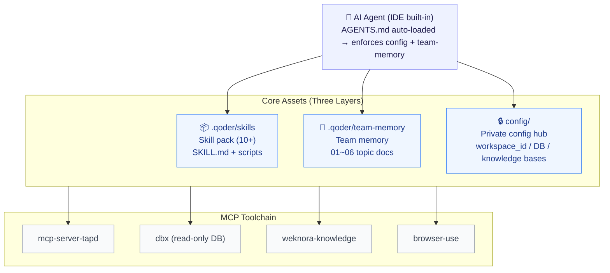

# QASkillKit — QA All-in-One Agent Skill Kit

<p align="center">
  🌐 <a href="README.md">中文</a> · <a href="README.en.md">English</a>
</p>

> **QA All-in-One AI Skill Kit: from prototype images to traceable test cases** — multi-channel OCR reads requirement diagrams → auto-generates cases (linked to change points) → case-vs-prototype consistency review → UI automation with results logged back → standardized defect & acceptance reports.
>
> **Real-data driven, zero AI hallucination** · **Pure Skill-driven, zero framework code** — all capabilities are Markdown skill docs (SKILL.md) with minimal utility scripts. Readable, editable, improvable.

---

## ✨ What It Does

| Area | Skill | How to Invoke | Description |
|:---|:---|:---|:---|
| 📝 Test Case Design | `mcpcase` | Input a TAPD requirement ID (e.g. `1019311`) | Fetches requirements from TAPD, queries real test data from DB, supplements business context from knowledge base, and OCRs prototype images to generate structured test cases. |
| 🔍 Case Review | `case-review` | `review 1019311` | Compares test cases against prototype images line by line; directly fixes confirmed mismatches, outputs a pending-confirmation report for ambiguous items. |
| 🖥️ UI Automation | `uitest` | `test 1019311` | Drives browser via browser-use MCP to execute Web-based test cases; groups and merges related cases, logs results back into case files. |
| 🐞 Defect Reports | `ai-testbug` | Describe the bug | Writes standardized defect documents following the team's defect template (title, preconditions, steps, actual/expected results). |
| 📊 Acceptance Reports | `acceptance-report` (/ys) | `generate s92 acceptance report` | Requirement/defect statistics, delayed-delivery lists, developer defect distribution; scripts connect directly to TAPD OpenAPI. |
| 📅 Weekly Reports | `weekly-report` (/zb) | `write weekly report` | Pulls requirement/defect updates from TAPD for the current week, generates a structured weekly report. |
| 🖼️ OCR | `ocr` | Called by other skills automatically | Three-channel cross-validated OCR: Windows OCR (coverage) + OpenOCR (precision) + VLM (structure). |
| ⚙️ Setup Wizard | `setup` (/setup) | `/setup` on first use | Auto-detects TAPD project, DB connections, knowledge bases; generates private config. |

## 🚀 Quick Start

### Prerequisites

| Dependency | Purpose | Required |
|:---|:---|:---:|
| [Qoder](https://qoder.com/) (or any IDE supporting AGENTS.md) | Runs agents & skills | ✅ Required |
| MCP: `mcp-server-tapd` | TAPD read/write | ✅ Required |
| MCP: `dbx` | DB read-only queries for real test data | Recommended |
| MCP: `browser-use` | UI automation | Required for uitest |
| MCP: `weknora-knowledge` | Business knowledge base | Optional |
| Python 3 + Node.js ≥ 18 | Utility scripts / OCR | ✅ Required |

### Get Started

```bash
# 1. Clone
git clone https://github.com/WL2O2O/QASkillKit.git && cd QASkillKit

# 2. Configure MCP services (tapd required, others optional)

# 3. Run the setup wizard
/setup
```

After `/setup` generates `config/project.config.json` (gitignored), you're ready:

```
/mcpcase 1019311        ← Generate test cases for TAPD requirement 1019311
test 1019311             ← Run UI automation for that requirement
/ys generate s92 report ← Generate acceptance report
/zb                     ← Generate this week's report
```

## 🏗️ Architecture



Three layers that compound in value:

1. **Skill layer** — each workflow is a SKILL.md with documented steps, pitfalls, and business rules
2. **Team memory layer** (`team-memory/`) — cross-skill knowledge and experience; git-tracked for the whole team
3. **Config layer** (`config/`) — all private info centralized in one place, gitignored, **the repo itself has zero sensitive data**

## 🧬 Design Principles

- **Pure Skill, zero framework** — no framework code to maintain; everything is natural-language MWP + simple scripts
- **Real data only** — test data must come from real DB queries or requirement originals; no AI-hallucinated cases
- **Human-AI boundary** — AI must not write to DB, execute payments, or other destructive operations; SQL is output-only for human execution
- **Compounding experience** — pitfalls from each run are fed back into team-memory and references
- **Cross-IDE compatible** — based on the standard AGENTS.md convention; works with Qoder, Claude Code, and more

## 🔒 Privacy & Confidentiality

All private info is managed through three gitignore zones:

| Location | Contents | Git Status |
|:---|:---|:---|
| `config/project.config.json` | TAPD workspace_id, team members, DB connections, knowledge UUIDs | 🚫 Ignored (template `project.config.example.json` checked in) |
| `.qoder/team-memory/local/` | Team-private knowledge (e.g. table lookups) | 🚫 Ignored |
| `.qoder/skills/uitest/references/local/` | Environment addresses, account rules, pitfalls | 🚫 Ignored (template `env-template.md` checked in) |

Credentials (TAPD token, API keys) never enter config files — tokens from MCP config, keys from environment variables. Passwords are "ask each time, never record."

## 📁 Directory Structure

```
├── AGENTS.md                    # Global agent instructions (auto-loaded)
├── config/                      # Private config center (template committed, real config gitignored)
├── .qoder/
│   ├── skills/                  # Skills (setup/mcpcase/uitest/acceptance-report/...)
│   │   └── {skill}/SKILL.md     #   Each skill has a complete procedure + scripts/
│   └── team-memory/             # Team memory (01~06 topic docs + local/ private)
├── examples/                    # Desensitized examples (fictional case format samples)
├── demo/                        # Real-case desensitized samples (showing output quality)
├── workspace/                   # Working area (only personal/drafts/ gitignored)
└── _tmp/                        # Temporary files (gitignored)
```

## 🤝 Contributing

- **New skill**: Follow the SKILL.md structure in `.qoder/skills/` (how to use → workflow overview → step-by-step → pitfalls → output spec)
- **Update specs**: Edit `team-memory/` topic docs directly; git commit makes it team-wide
- **Hard rule**: Private info only in `config/` and `local/`; never hardcode into any committed file

## 📄 License

[MIT](LICENSE)