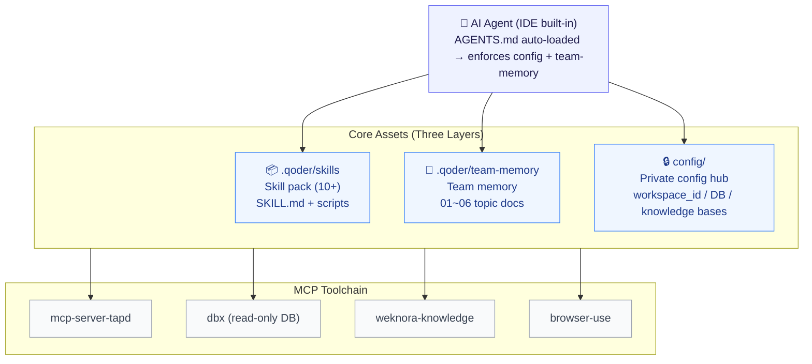

# QASkillKit — QA All-in-One Agent Skill Kit

<p align="center">
  🌐 <a href="README.md">中文</a> · <a href="README.en.md">English</a>
</p>

<p align="center">
  <a href="https://github.com/WL2O2O/QASkillKit/actions/workflows/evals.yml"></a>
</p>

> **QA All-in-One AI Skill Kit: from prototype images to traceable test cases** — multi-channel OCR reads requirement diagrams → auto-generates cases (linked to change points) → case-vs-prototype consistency review → UI automation with results logged back → standardized defect & acceptance reports.
>
> **Real-data driven, zero AI hallucination** · **Pure Skill-driven, zero framework code** — all capabilities are Markdown skill docs (SKILL.md) with minimal utility scripts. Readable, editable, improvable.

---

## ✨ What It Does

| Area | Skill | Alias / Shortcut | How to Invoke | Description |
|:---|:---|:---|:---|:---|
| 📝 Test Case Design | `testcase-generator` | — | Input a TAPD requirement ID (e.g. `1019311`) | Fetches requirements from TAPD, queries real test data from DB, supplements business context from knowledge base, and OCRs prototype images to generate structured test cases. |
| 🔍 Case Review | `testcase-reviewer` | — | `review 1019311` | Compares test cases against prototype images line by line; directly fixes confirmed mismatches, outputs a pending-confirmation report for ambiguous items. |
| 🖥️ UI Automation | `ui-automation` | — | `test 1019311` | Drives browser via browser-use MCP to execute Web-based test cases; groups and merges related cases, logs results back into case files. |
| 🐞 Defect Reports | `defect-logger` | — | Describe the bug | Writes standardized defect documents following the team's defect template (title, preconditions, steps, actual/expected results). |
| 📊 Acceptance Reports | `acceptance-report` | `/ys` | `generate s92 acceptance report` | Requirement/defect statistics, delayed-delivery lists, developer defect distribution; scripts connect directly to TAPD OpenAPI. |
| 📅 Weekly Reports | `weekly-report` | `/zb` | `write weekly report` | Pulls requirement/defect updates from TAPD for the current week, generates a structured weekly report. |
| 🖼️ OCR | `ocr` | — | Called by other skills automatically | Three-channel cross-validated OCR: Windows OCR (coverage) + OpenOCR (precision) + VLM (structure). |
| ⚙️ Setup Wizard | `setup` | `/setup` | `/setup` on first use | Auto-detects TAPD project, DB connections, knowledge bases; generates private config. |
| 🧪 Agent Evaluation | `evals/` module | — | `python3 evals/evaluate.py` | YAML eval set + rule assertions / LLM-as-Judge dual channel; runs with zero keys, no TAPD needed, negative-control self-test. |
| 🧪 Case Evaluation | `testcase-evaluator` | `/eval` | `evaluate this case file` / `run evals` | Conversational entry to the evals module: picks registered eval / repo-wide scan / --live, explains violations in plain language; badcase root causes and calibration stay human-confirmed. |

## 🚀 Quick Start

Pick a track: **just trying it out → Track A** (30 seconds, Python only); **your team uses TAPD and wants the full workflow → Track B**.

### Track A: Evaluate test cases in 30 seconds (no TAPD, no key, no IDE)

```bash
git clone https://github.com/WL2O2O/QASkillKit.git && cd QASkillKit
pip install pyyaml
python3 evals/evaluate.py
```

You'll see: of the 3 bundled case files, the 2 good ones pass and the intentionally bad one has every violation flagged (the evaluator is no rubber stamp). Reports land in `evals/reports/`.

Want the AI to write cases on the fly and grade them? `export GLM_API_KEY=your_key`, then run `python3 evals/evaluate.py --live`. To feed in your own requirements or case files, follow the step-by-step guide in [evals/README.md](evals/README.md).

### Track B: Full QA workflow (TAPD teams)

Prerequisites:

| Dependency | Purpose | Required |
|:---|:---|:---:|
| [Qoder](https://qoder.com/) (or any IDE supporting AGENTS.md) | Runs agents & skills | ✅ Required |
| MCP: `mcp-server-tapd` | TAPD read/write | ✅ Required |
| MCP: `dbx` | DB read-only queries for real test data | Recommended |
| MCP: `browser-use` | UI automation | Required for ui-automation |
| MCP: `weknora-knowledge` | Business knowledge base | Optional |
| Python 3 + Node.js ≥ 18 | Utility scripts / OCR | ✅ Required |

Get started in 3 steps:

```bash
# 1. Clone
git clone https://github.com/WL2O2O/QASkillKit.git && cd QASkillKit

# 2. Configure MCP services (tapd required, others optional)

# 3. Run the setup wizard
/setup
```

After `/setup` generates `config/project.config.json` (gitignored), you're ready:

```
/testcase-generator 1019311   ← Generate test cases for TAPD requirement 1019311
test 1019311             ← Run UI automation for that requirement
/ys generate s92 report ← Generate acceptance report
/zb                     ← Generate this week's report
/eval                   ← Evaluate case quality (no TAPD, zero keys needed)
```

## 🧪 Agent Evaluation (public entry, no TAPD needed)

Clone and run without any TAPD project — experience the core methodology: **QA for AI itself**.

```bash
pip install pyyaml
python3 evals/evaluate.py        # zero keys: rule channel + bundled desensitized outputs, baseline report
```

Provide any OpenAI-compatible key (e.g. `GLM_API_KEY`) to enable the LLM-as-Judge channel; `--live` makes the SUT prompt generate cases on the fly before evaluation. The eval set includes a **negative control** (intentionally bad output) that the evaluator must fully detect; the exit code is CI-ready for prompt regression. See [evals/README.md](evals/README.md).

**Bring your own cases** — register with one command, no hand-written YAML:

```bash
python3 evals/evaluate.py --add path/to/cases.md --fixture path/to/requirement.md --points ①②
```

**What the report looks like** (excerpt from a real baseline; reports are currently in Chinese; full versions in `evals/reports/`):

```markdown
# 评测基线报告 2026-11-12（offline+judge）
- 判别力自测（负向对照）：✅ 全部检出
- 变更点覆盖：8/8

| case | 类型 | 规则通道 | Judge | 结论 |
|:---|:---|:---|:---|:---|
| tc-1000001-good | positive | ✅ | 4.8 | pass |
| tc-1000002-good | positive | ✅ | 5.0 | pass |
| tc-1000001-negative | negative-control | ❌ | 3.0 | detected |

- **tc-1000001-negative / priority_valid**：行1 优先级'P5'非法
- **tc-1000001-negative / coverage**：变更点③未被任何用例覆盖
```

## 🏗️ Architecture



Three layers that compound in value:

1. **Skill layer** — each workflow is a SKILL.md with documented steps, pitfalls, and business rules
2. **Team memory layer** (`team-memory/`) — cross-skill knowledge and experience; git-tracked for the whole team
3. **Config layer** (`config/`) — all private info centralized in one place, gitignored, **the repo itself has zero sensitive data**

## 🧬 Design Principles

- **Pure Skill, zero framework** — no framework code to maintain; everything is natural-language MWP + simple scripts
- **Real data only** — test data must come from real DB queries or requirement originals; no AI-hallucinated cases
- **Human-AI boundary** — AI must not write to DB, execute payments, or other destructive operations; SQL is output-only for human execution
- **Compounding experience** — pitfalls from each run are fed back into team-memory and references
- **Cross-IDE compatible** — based on the standard AGENTS.md convention; works with Qoder, Claude Code, and more

## 🔒 Privacy & Confidentiality

All private info is managed through three gitignore zones:

| Location | Contents | Git Status |
|:---|:---|:---|
| `config/project.config.json` | TAPD workspace_id, team members, DB connections, knowledge UUIDs | 🚫 Ignored (template `project.config.example.json` checked in) |
| `.qoder/team-memory/local/` | Team-private knowledge (e.g. table lookups) | 🚫 Ignored |
| `.qoder/skills/ui-automation/references/local/` | Environment addresses, account rules, pitfalls | 🚫 Ignored (template `env-template.md` checked in) |

Credentials (TAPD token, API keys) never enter config files — tokens from MCP config, keys from environment variables. Passwords are "ask each time, never record."

## 📁 Directory Structure

```
├── AGENTS.md                    # Global agent instructions (auto-loaded)
├── config/                      # Private config center (template committed, real config gitignored)
├── evals/                       # Agent evaluation module (public entry: YAML eval set + dual-channel evaluator + baseline reports)
├── .qoder/
│   ├── skills/                  # Skills (setup/testcase-generator/ui-automation/acceptance-report/...)
│   │   └── {skill}/SKILL.md     #   Each skill has a complete procedure + scripts/
│   └── team-memory/             # Team memory (01~06 topic docs + local/ private)
├── examples/                    # Desensitized examples (fictional case format samples)
├── demo/                        # Real-case desensitized samples (showing output quality)
├── workspace/                   # Working area (only personal/drafts/ gitignored)
└── _tmp/                        # Temporary files (gitignored)
```

## 🤝 Contributing

- **New skill**: Follow the SKILL.md structure in `.qoder/skills/` (how to use → workflow overview → step-by-step → pitfalls → output spec)
- **Update specs**: Edit `team-memory/` topic docs directly; git commit makes it team-wide
- **Hard rule**: Private info only in `config/` and `local/`; never hardcode into any committed file

## 📄 License

[MIT](LICENSE)