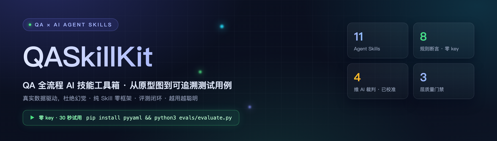
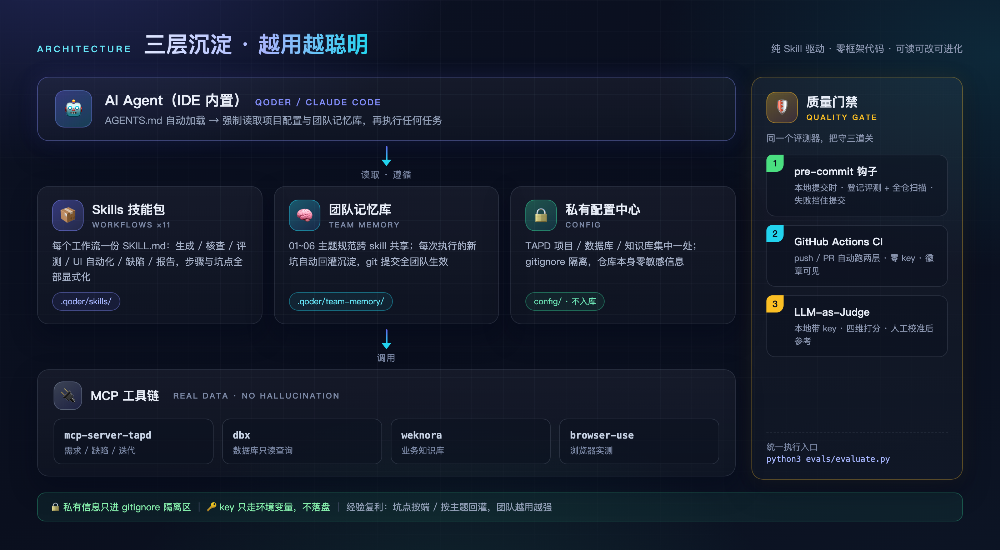
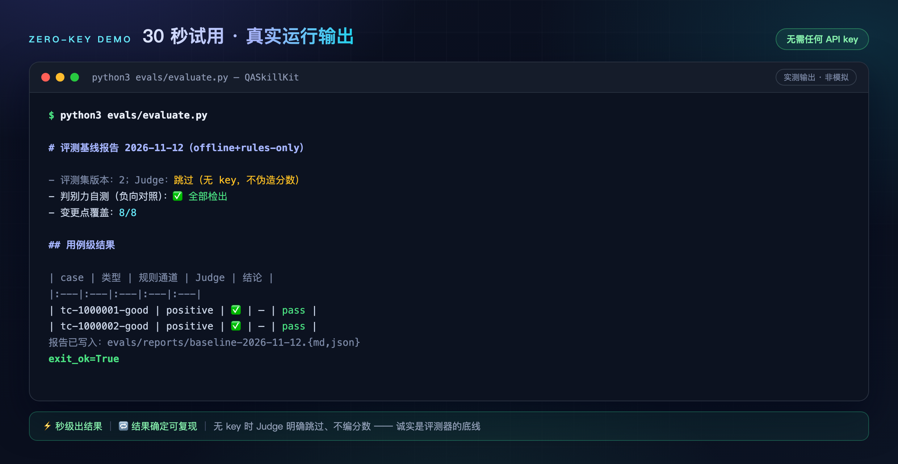
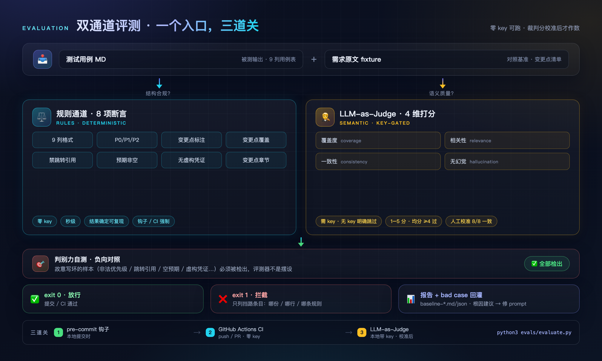
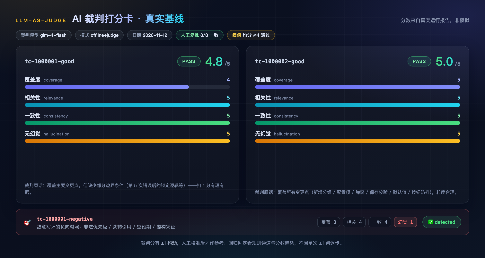

<p align="center">
  
</p>

# QASkillKit — QA 全流程技能工具箱

<p align="center">
  🌐 <a href="README.md">中文</a> · <a href="README.en.md">English</a>
</p>

<p align="center">
  <a href="https://github.com/WL2O2O/QASkillKit/actions/workflows/evals.yml"></a>
</p>

> **QA 全流程 AI 技能包：从原型图到可追溯测试用例**——多轨 OCR 识别需求图 → 自动生成用例（关联变更点）→ 用例与原型逐条一致性核查 → UI 自动化执行回填 → 规范化缺陷/验收报告。
>
> **真实数据驱动，杜绝 AI 幻觉** · **纯 Skill 驱动，零框架代码**——全部能力以 Markdown 技能文档（SKILL.md）+ 少量固化脚本沉淀，可读、可改、可进化。

---

## ✨ 它能做什么

| 环节 | Skill | 别名/快捷命令 | 触发方式 | 说明 |
|:---|:---|:---|:---|:---|
| 📝 测试用例设计 | `testcase-generator` | — | 输入 TAPD 需求 ID，如 `1019311` | TAPD 拉需求 + 数据库查真实测试数据 + 知识库补业务上下文 + 原型图三轨 OCR 识图，生成结构化用例 |
| 🔍 用例核查 | `testcase-reviewer` | — | `核查 1019311` | 用例与原型图逐条比对，有据直接修正，存疑输出待确认报告 |
| 🖥️ UI 自动化测试 | `ui-automation` | — | `测试 1019311` | browser-use 驱动浏览器实测网页端用例，智能分组合并执行，结果回填用例文件 |
| 🐞 缺陷报告 | `defect-logger` | — | 描述缺陷现象 | 按团队缺陷模板生成规范缺陷文档（三级标题命名/复现步骤/预期实际） |
| 📊 迭代验收报告 | `acceptance-report` | `/ys` | `生成 s92 验收报告` | 需求/缺陷统计、未按时提测清单、开发缺陷分布，固化脚本直连 TAPD OpenAPI |
| 📅 周报生成 | `weekly-report` | `/zb` | `写周报` | 从 TAPD 拉取本周需求/缺陷动态，按指南生成结构化周报 |
| 🖼️ 三轨 OCR 识图 | `ocr` | — | 被其他 skill 自动调用 | Windows OCR（覆盖率）+ OpenOCR（精读）+ VLM（结构）三通道交叉验证 |
| ⚙️ 初始化向导 | `setup` | `/setup` | 首次使用运行 | 自动探测 TAPD 项目/数据库连接/知识库，生成私有配置 |
| 🧪 Agent 评测 | `evals/` 模块 | — | `python3 evals/evaluate.py` | YAML 评测集 + 规则断言/LLM-as-Judge 双通道；零 key 可跑、无需 TAPD，负向对照自测；评测器自身另有 pytest 自测 |
| 🧪 用例评测 | `testcase-evaluator` | `/eval` | `评测一下这份用例` / `跑评测` | evals 模块的对话入口：自动选登记评测/全仓扫描/--live，人话解读违规，badcase 根因与校准待人工确认 |

## 🏗️ 架构设计

<!-- 图源：docs/assets/src/architecture.html，改文案后跑 bash docs/assets/src/render.sh architecture 重渲染 -->

<p align="center">
  
</p>

三层沉淀，越用越聪明：

1. **Skill 层**：每个工作流一个 SKILL.md，步骤、坑点、口径全部显式化，AI 严格照此执行
2. **团队记忆层**（`team-memory/`）：跨 skill 共享的项目规范与踩坑经验，git 提交全团队共享；每次执行遇到新坑自动回灌沉淀
3. **配置层**（`config/`）：全部私有信息（TAPD 项目、团队成员、数据库、知识库）集中一处、gitignore 隔离，**仓库本身零敏感信息**

## 🚀 快速开始

按你的情况选一条轨道：**只想试试 → 轨道 A**（30 秒，只要 Python）；**团队用 TAPD、要完整流程 → 轨道 B**。

### 轨道 A：30 秒试用例评测（无 TAPD、无 key、无 IDE）

```bash
git clone https://github.com/WL2O2O/QASkillKit.git && cd QASkillKit
pip install pyyaml
python3 evals/evaluate.py
```

<p align="center">
  
</p>

你会看到：仓库自带的 12 份用例，好的 3 份通过，故意写坏的 9 份全部被揪出（其中 8 份每份只坏一处——8 条规则各有一发"单规则隔离弹"，证明评测器不是橡皮图章），报告存到 `evals/reports/`。

想让 AI 当场写、当场评？`export GLM_API_KEY=你的key` 后跑 `python3 evals/evaluate.py --live`。想喂自己的需求/用例，逐步教程见 [evals/README.md](evals/README.md)。

### 轨道 B：完整 QA 工作流（TAPD 团队）

前置要求：

| 依赖 | 用途 | 必需性 |
|:---|:---|:---|
| [Qoder](https://qoder.com/)（或兼容 AGENTS.md 规范的 AI IDE） | 运行 Agent 与 Skill | ✅ 必需 |
| MCP: `mcp-server-tapd` | TAPD 需求/缺陷/迭代读写 | ✅ 必需 |
| MCP: `dbx` | 数据库只读查询（真实测试数据） | 推荐 |
| MCP: `browser-use` | UI 自动化测试 | ui-automation 需要 |
| MCP: `weknora-knowledge` | 业务知识库补充 | 可选 |
| Python 3 + Node.js ≥ 18 | 固化脚本/OCR/下载脚本 | ✅ 必需 |

三步跑起来：

```bash
# 1. 克隆仓库
git clone https://github.com/WL2O2O/QASkillKit.git && cd QASkillKit

# 2. 在 IDE 中配置好 MCP 服务（tapd 必需，其余按需）

# 3. 在 AI 对话框运行初始化向导
/setup
```

`/setup` 会自动探测 TAPD 项目、数据库连接、知识库清单，生成 `config/project.config.json`（gitignore，不会提交）。之后直接开始使用：

```
/testcase-generator 1019311   ← 为 TAPD 需求 1019311 生成测试用例
测试 1019311             ← UI 自动化执行该需求的用例
/ys 生成 s92 验收报告     ← 生成迭代验收报告
/zb                     ← 生成本周周报
/eval                   ← 评测用例质量（无需 TAPD，零 key 可跑）
```

## 🧪 Agent 评测（公开入口，无需 TAPD）

这个模块是"改作业的老师"：只改已经写好的测试用例，全程不碰 TAPD。三种情况：

<!-- 图源：docs/assets/src/eval-gate.html，改文案后跑 bash docs/assets/src/render.sh eval-gate 重渲染 -->
<p align="center">
  
</p>

```bash
pip install pyyaml
python3 evals/evaluate.py               # ① 只想试试：改仓库自带的 3 份用例，零 key
export GLM_API_KEY=你的key               # ② 有 key：AI 用需求文字当场写简化版用例再改
python3 evals/evaluate.py --live
```

③ 团队有 TAPD：真实 skill 生成用例后，喂进来用同一套标准改。**有自己的需求文字？** 一条命令登记：`python3 evals/evaluate.py --add 你的用例.md --fixture 你的需求.md --points ①②`，免手写 YAML。三种情况的逐步教程见 [evals/README.md](evals/README.md)。

评测器自己也要被评测：自带 pytest 自测锁住规则边界、表格解析、扫描逻辑与判别力保证（`pip install -r requirements.txt && python3 -m pytest evals/tests -q`，零 key 秒级），CI 同样跑。

改了 prompt / 换了模型，想知道变好还是变坏？两份报告一条命令回归对比：`python3 evals/evaluate.py --diff 旧.json 新.json`，逐用例逐规则列出退步/变好（Judge ±1 抖动不算退步），退出码可直接当回归门禁。报告文件名带时分秒，同日重跑互不覆盖。

想直接看效果：`bash evals/ab-demo.sh`（需 key）拿正式版 prompt 和一份**故意弱化版**各跑一次 `--live` 再自动对比。2026-11-13 真实运行判出 37 项退步（变更点覆盖 13/13 → 0/13、`exit_ok` True → False），还顺手暴露了评测器自己的一个漏检盲区（表格列数漂移后行级检查被跳过）——已修复并用这次的真实产物做自测锚点，产物与对比报告都在 `evals/ab-demo/`。同一次演示还量出裁判通道的短板：退化产出规则通道查出覆盖 0/5，LLM 裁判却给四维全 5.0——据此把 coverage/consistency 的评分标准收紧（评测集升 v4）并 export key 复跑验证：B 的 coverage 确实从 5/5/5 掉到 3/3/4，但四维均分 4.50/4.50/4.75 **仍然过线**，而且裁判把"逐点核对"演出来了、结论是编的（覆盖 0 点被写成"1~6 均覆盖"，反过来全覆盖的正样本被扣成"仅覆盖 3/5"）。结论写进 `evals/README.md` 与 bc-0005：**机械可判的事不能指望小模型裁判，门禁只认规则通道，Judge 分数一律当参考。**顺着这个结论又做了评测集 v5：把评测集里的变更点清单与规则通道的判定结果直接喂给裁判（不许它自己拆清单、不许推翻规则结论），coverage 只评边界值/异常场景/粒度这些机器判不了的事——**v5 已 export key 复跑验证并达标**：弱化版 B 的四维均分从 v4 的 4.50/4.50/4.75（全部过线）掉到 2.75/3.25/2.25（首次全部不及格），矛盾率 54% → 4%，正式版 A 仍 4.75/4.75/4.25；随后 v6 又治了一条"规则查出虚构凭证、裁判却写'无虚构'还打 5 分"的老毛病（把 hallucination 定义与规则通道结论绑死）。顺手把「裁判有没有自相矛盾」做成了自动指标：`python3 evals/evaluate.py --judge-agreement 报告.json` 拿裁判的四维分数与规则通道的确定性结论交叉核对，算出矛盾率（比如规则查出优先级写了「高」、裁判却在 consistency 给 5 分说「优先级使用 P0/P1/P2」，这就是一次矛盾）。用它离线重算十一份已存档的真实报告：最早的 v2 基线 67%、v3 那轮弱化产出 74%、v4 收紧标准后 36%~54%、v5 喂事实后 4%~7%、v6 7%——「门禁只认规则通道」从此有量化依据。反向可疑（裁判在没有规则证据的地方压分）一栏在 v6 之后按放宽的口径重算过：老实现只查"规则 8 项全过"的用例，漏掉了"规则确实有违规、但违规的是别的维度"这种情形，早期文档写的"六份都是 0"已作废，现在十一份是 0~4 项（v6 重复评那轮 4 项，全是同一个占位误判），每项都交人工复批。再往前一步做了裁判稳定性度量：`python3 evals/evaluate.py --runs 3` 把同一份产出连评三轮，输出 pass@3、每个维度的极差与「结论翻转」清单。2026-11-14 真实跑（12 条用例 × 3 轮 = 36 次裁判调用）：三条正样本全 3/3 过线、最大极差 ≤1，分数可复现；唯一不稳定的是负向对照 tc-neg-expected-empty 的 hallucination 给出 1→1→5（极差 4）、`pass@3` 只有 1/3——**同一份产出忽过忽不过，这种用例的 Judge 结论单跑一次不能采信**。更有用的是它把两类老问题分了性质：三条负向对照的 hallucination 三轮全给 1 分（极差 0，理由都说 fixture 里的"账号 A"是虚构凭证，可那几份 fixture 根本没有凭证）——**稳定地错就不是抖动，是评分标准的口径问题**（bc-0009）；而 consistency 那句"这是格式问题不是内容不一致"的绕过说辞三轮里只出现一次（bc-0008），单跑碰不到、重复评才看得见。稳定性只诊断裁判本身，不参与退出码。

**报告长什么样**（真实基线节选：好的 2 份通过，故意写坏的 1 份被全部检出；完整版在 `evals/reports/`）：

```markdown
# 评测基线报告 2026-11-12（offline+judge）

- 评测集版本：2；Judge：启用（glm-4-flash，key 来源 EVAL_LLM_API_KEY）
- 判别力自测（负向对照）：✅ 全部检出
- 变更点覆盖：8/8

## 用例级结果

| case | 类型 | 规则通道 | Judge | 结论 |
|:---|:---|:---|:---|:---|
| tc-1000001-good | positive | ✅ | 4.8 | pass |
| tc-1000002-good | positive | ✅ | 5.0 | pass |
| tc-1000001-negative | negative-control | ❌ | 3.0 | detected |

……

## 违规明细与建议根因（根因须人工确认，见 badcases.yaml）

- **tc-1000001-negative / priority_valid**（建议根因：prompt）：行1 优先级'P5'非法
- **tc-1000001-negative / no_jump_refs**（建议根因：prompt）：行2 前置条件含跳转引用
- **tc-1000001-negative / coverage**（建议根因：prompt）：变更点③未被任何用例覆盖
……
```

裁判打分明细长这样（真实基线，四维 1–5 分；故意写坏的负向对照被识破）：

<p align="center">
  
</p>

## 🔒 隐私与脱敏设计

本仓库可直接公开，所有私有信息通过三个 gitignore 隔离区管理：

| 位置 | 存放内容 | git 状态 |
|:---|:---|:---|
| `config/project.config.json` | TAPD workspace_id、团队成员、数据库连接、知识库 UUID、归档路径 | 🚫 忽略（模板 `project.config.example.json` 入库） |
| `.qoder/team-memory/local/` | 团队私有知识（如业务表速查） | 🚫 忽略 |
| `.qoder/skills/ui-automation/references/local/` | 各端测试环境地址/账号规则/端特有坑点 | 🚫 忽略（模板 `env-template.md` 入库） |

凭证类（TAPD token、API Key）不进任何配置文件：token 从 MCP 配置读取，Key 从环境变量读取。密码类一律"每次询问，不记录"。

## 📁 目录结构

```
├── AGENTS.md                    # Agent 全局指令（自动加载，强制读配置+记忆库）
├── config/                      # 私有配置中心（模板入库，真实配置 gitignore）
├── evals/                       # Agent 评测模块（公开入口：YAML 评测集 + 双通道评测器 + 基线报告）
├── .qoder/
│   ├── skills/                  # 技能包（setup/testcase-generator/ui-automation/acceptance-report/...）
│   │   └── {skill}/SKILL.md     #   每个技能的完整执行规程 + scripts/ 固化脚本
│   └── team-memory/             # 团队记忆库（01~06 主题方法论 + local/ 私有）
├── examples/                    # 脱敏示例（虚构用例格式样例）
├── demo/                        # 真实用例脱敏示例（演示产出质量）
├── workspace/                   # 业务工作区（仅 personal/drafts/ 草稿副本 gitignore，其余入库）
└── _tmp/                        # 临时文件（gitignore）
```

## 🧬 设计理念

- **纯 Skill，零框架**：没有一行需要维护的框架代码，全部能力用自然语言规程 + 少量单文件脚本表达，任何人可读懂、可定制
- **真实数据，禁止虚构**：测试数据必须来自数据库真实查询或需求原文，从源头杜绝 AI 幻觉用例
- **人机协作边界清晰**：AI 禁止写库、禁止执行推送/支付等高危操作，SQL 只输出给人执行
- **经验复利**：每次执行的坑点按端/按主题回灌到 team-memory 与 references，团队越用越强
- **跨 IDE 兼容**：基于通用 AGENTS.md 规范，Qoder / Claude Code 等均可加载；仓库自带 `.claude/skills → .qoder/skills` 软链，Claude Code 克隆即用（Windows 若软链不生效，管理员终端执行 `mklink /D .claude\skills ..\.qoder\skills`）

## 🤝 贡献与二次开发

- 新增技能：参照 `.qoder/skills/` 任一 SKILL.md 的结构（使用方式 → 执行流程总览 → 分步规程 → 坑点 → 输出规范）
- 修改规范：直接编辑 `team-memory/` 主题文档，git 提交即团队生效
- 硬性红线：私有信息只进 `config/` 与 `local/`，禁止硬编码进任何入库文件（详见 `AGENTS.md`）

## 📄 License

[MIT](LICENSE)
