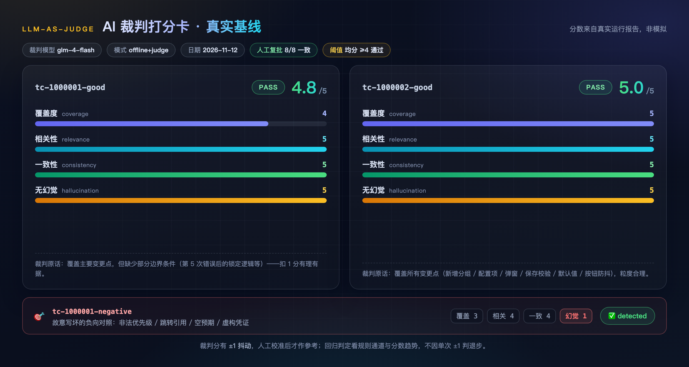
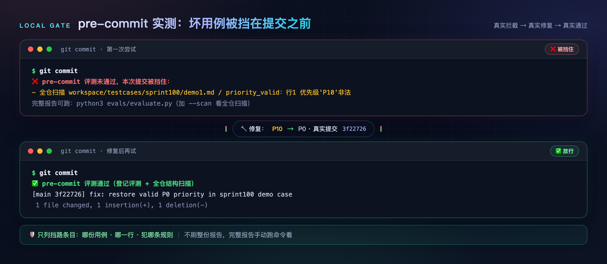

# evals — 用例"改作业"模块（无需 TAPD，克隆即跑）

> 一句话说明：这个模块是**改作业的老师**——只改已经写好的测试用例，不管用例是谁写的、怎么写的。
> 写用例是 testcase-generator skill 的事（它要去 TAPD 拿需求）；改用例是本模块的事（只看用例文件，全程不碰 TAPD）。
>
> Agent 用户：在 Qoder/Claude Code 里直接说 `/eval` 或"评测一下这份用例"（testcase-evaluator skill），
> 自动选模式、跑完人话解读；能力本体与教程仍是本模块。

## 先对号入座：你是哪种情况？

| 情况 | 你手里有什么 | 看哪节 |
|:---|:---|:---|
| 只想试试这个仓库 | 什么都没有（无 TAPD、无 key） | 情况 1 |
| 有大模型 API key，没有 TAPD | 一个 key | 情况 2（可用自带需求文字，也可用**你自己的需求文字**） |
| 团队有 TAPD 完整环境 | 全套环境 | 情况 3 |

## 情况 1：零 key 试用（改仓库自带的作业）

```bash
pip install pyyaml          # 唯一运行依赖（跑评测器自测另需 pytest，见「评测器自测」节）
python3 evals/evaluate.py
```

不需要 TAPD、不需要 key、不需要任何配置。仓库自带 12 份用例：3 份好的、9 份故意写坏的。
你会看到：好的 3 份通过；坏的 9 份全部被揪出——其中 1 份是"多处一起坏"的混合样本，另外 8 份每份只坏一处（8 条规则各有一发单规则隔离弹，证明每条规则独立可检出）；报告存到 `evals/reports/`。

## 情况 2：有 key，让 AI 当场写、当场改

key 是什么：任意 OpenAI 兼容大模型的 API key（比如智谱 GLM）。**只在终端 export，不写进任何文件**：

```bash
export GLM_API_KEY=你的key
python3 evals/evaluate.py --live
```

会发生什么：AI 读仓库自带的需求文字，当场写一份用例，然后老师改这份新作业。
注意这是**简化版**：AI 只看文字，不识别原型图、不查数据库。完整流程见情况 3。

想验证"换了 prompt 质量会不会掉"？一条命令跑 A/B 对比（正式版 prompt vs 故意弱化版），见「A/B prompt 回归演示」节。
想知道"AI 老师的分数能不能复现"？`python3 evals/evaluate.py --runs 3` 把同一份作业连评三轮，给出 pass@3、各维度极差与结论翻转清单，见「裁判稳定性」节。
想知道"AI 老师有没有自相矛盾"？`python3 evals/evaluate.py --judge-agreement 报告.json`（零 key、离线重算），见「裁判-规则一致率」节。

### 有自己的需求文字？一条命令登记

准备两个文件：**需求文字**（纯文本写清楚即可：改了什么、规则是什么、提示文案是什么）和**你的用例文件**。然后：

```bash
python3 evals/evaluate.py --add 你的用例.md --fixture 你的需求.md --points ①②
```

这条命令会：把需求拷进 `evals/fixtures/`、在 `cases.yaml` 末尾追加一条登记（保留已有注释），之后每次评测都会带上你的用例。用例文件留在原地（按原路径引用，不拷贝）。

- `--points` 可以省略：会从用例文件的「变更点说明」表自动提取编号；
- **要脱敏**：别放真实公司名、账号密码、内网地址（这个仓库是公开的）。
- **想让裁判也靠谱点（v5 新增）**：在 `cases.yaml` 顶部的 `change_points:` 段里，按 fixture 路径给每个编号写一句变更点描述（编号必须与该用例的 `expected_change_points` 一致，pytest 会锁）。评测器会把这份清单直接喂给裁判，它就不必自己从需求里拆——v4 实测小模型自己拆会拆错、还会编出"覆盖 6/6"这种结论（bc-0005）。不写也能跑：裁判会收到"未登记"提示，自行拆分并在理由里先列出清单。

`--points`（即 YAML 里的 `expected_change_points`）是什么：你从需求里挑出的要点，自己编上 ①②③。AI 写用例时会给每条用例标注"测的是哪个要点"，老师按编号检查**每个要点是否都有用例测到**。

**想手写 YAML？** 也可以手动登记：需求文字放进 `evals/fixtures/`，再在 `evals/cases.yaml` 的 `cases:` 末尾加一条：

```yaml
  - id: my-first-case                 # 自己起名，别重复
    kind: positive
    fixture: fixtures/my-requirement.md
    output: ../你的用例文件路径.md      # 路径相对 evals/；用 --live（AI 当场写）时省略这行
    expected_change_points: ["①", "②"]
```

登记完跑情况 1 或情况 2 的命令。完事。

## 情况 3：团队完整流程（有 TAPD）

1. 照常用 testcase-generator 生成用例（**这一步才用 TAPD**）；
2. 需求文字脱敏后放 `fixtures/`，用例文件脱敏后放仓库任意位置；
3. 按情况 2 登记（`--add` 一条命令，或手写 fixture + output + expected_change_points）；
4. `python3 evals/evaluate.py`。

TAPD 只用在第 1 步"写"；改作业的老师依然不碰 TAPD。

## 老师改什么（两个通道）

**通道 1 规则检查（零 key 就有）**，8 项：

1. 用例表格式对不对（固定 9 列）；
2. 优先级是不是 P0/P1/P2；
3. 每条用例有没有标注测的哪个变更点；
4. 每个变更点是不是都有用例测到；
5. 有没有"见上文/参见/同上"这种让人翻来翻去的写法；
6. 预期结果有没有空着；
7. 有没有编造的密码、内网地址；
8. 有没有变更点说明。

**通道 2 再请一个 AI 打分（有 key 自动开启）**：覆盖全不全、相不相关、步骤和预期对不对得上、有没有编造，四个方面各打 1-5 分，平均 ≥4 算过。
没有 key 时这个通道**明确跳过，不编分数**。AI 打分不百分百准，正式使用前要抽样人工复批改一致率；校准前分数只作参考。

## 裁判校准实录（2026-11-12，真实运行）

AI 裁判第一次真实打分，抓出的竟是**裁判自己的问题**——这正是"校准"要干的事：

- **现象**：两份好用例的"无幻觉"维度都被打 1 分（最差），均分 3.5 低于及格线 4，被误判不合格。
- **人工复批改因**：一份的理由是"实际结果列未填写"——那一列本来就该执行时才填，空着正常；另一份的理由写"没有虚构"却给了 1 分——理由和分数自相矛盾，裁判没搞懂这个维度"分越高越干净"。
- **根因**：评分标准（judge prompt）没写清维度含义和方向，属评测集自身问题（evalset），不是用例的错。登记在 `badcases.yaml` bc-0001 / bc-0002。
- **修复**：给裁判补上维度定义（`DIM_DEFS`）和三条评审约定（实际结果列为空正常 / 理由必须与分数同向 / 文件头部元信息不参与打分）；评测集版本升至 v2（改标准必须升版本、重跑基线）。
- **复评**：两份好用例通过（v2 基线均分 4.8 / 5.0），负向对照仍全部检出。修复前原始报告存档为 `reports/calibration-2026-11-12-before.*`（v1），可对照。
- **同日 --live 全链路实测**：glm-4-flash 现场生成两份用例 → 规则 8/8 通过 → 裁判均分 5.0（live 报告与生成产物在 `_tmp/`，不入库）。

**人工校准结果（2026-11-12）**：复评的 8 个分数（2 份正样本 × 4 维度）经人工逐条复批，8/8 全部认可，一致率 100%，记录在 `calibration.yaml`（cal-0001）。注意样本量小，一致率只代表本批；评测集扩充后要继续抽样校准。
**2026-11-18 第二批校准（cal-0002，v7）**：21 个分数先由跨模型 AI 复核逐条判定（分数级 17/21、严格级 14/21，逐条证据见 `reviews/v7-ai-review.md`），本人抽检 5 项（4 项争议 + 1 项正样本）全部认可后记入。这是**"AI 复核 + 人工抽检背书"**，不是 21 项人工逐条复批，对外引用须注明；抽检子集恰好是裁判错误项，单独一致率 1/5，不可外推。
**2026-11-18 第三批校准（cal-0003，v8）**：`reports/baseline-2026-11-18-161427.*` 的 14 个分数（3 份正样本 × 4 维 + 2 条负向对照各 1 个争议维度）由本人在对话中逐项复批，**分数级 12/14（85.7%）**。两条分歧都是负向对照分值超上限（P5 优先级、缺变更点章节，规则通道有据、上限 ≤3 裁判给 4）；**严格级只有 8/14**——另有四处分值被认可但举证编造（列数差异、库存批次分支、锁定期间登录、防抖边界，均能在产出里找到对应用例）。结论：v8 的"反向可疑 0"是放宽到不判错的代价，"判对时也会编理由"没解决，故 bc-0010/bc-0011 仍 confirmed、bc-0012 等代码侧截断。
**2026-11-18 第四批：其余十三份"授权口径代批"（cal-0004）**：本人授权按 cal-0003 的判定口径（有规则证据且未超上限即认可，超上限/事实相反即不认可，举证编造记严格级失败）把十三份带 Judge 报告一次过完，逐条判定由 AI 执行、本人未逐项阅读。范围是 584 个分数里**有规则证据的 212 个**（其余 372 个无规则证据，AI 不判）。结果：分数级 **171/212（80.7%）**、严格级 **146/212（68.9%）**；41 个不认可集中在 v3/v4（093523 单篇 11 个、170848 9 个，与 bc-0004/bc-0005 一致），v8 的 160734 只剩 1 个、155846 为 0；严格级再扣 17 项反向可疑（v6 拿"账号 A"当虚构的 4 项、v8 155846 的 2 项）与 8 处编造举证（称列数错误/列结构不一致/跳转引用而规则无对应违规）。**这条与前三批不可混算**：cal-0001/0003 是人工逐项，cal-0002 是人工抽检背书，cal-0004 是授权 + 口径；对外只能说"十三份已按人工口径代批"，不能说"人工已复批完毕"。
**2026-11-13 评测集扩至 v3（12 条）**：新增正样本 tc-1020256-executed 与 8 份单规则隔离负向对照已跑过 Judge（`reports/baseline-2026-11-13-165241.*`，12 条全有分数），但**尚未人工抽样复批**——按本节方法复批后追加 cal 记录，在此之前这批新样本的 Judge 分数只作参考（负向对照的判定本来就靠规则通道，不受影响）。

**2026-11-13 第二次校准：v3 → v4（收紧 coverage / consistency）**：A/B prompt 演示发现裁判对"格式与覆盖退化"几乎无感——B 变体那份产出规则通道查出变更点覆盖 0/5、缺变更点说明、6 列表格、4 处"同上"，裁判却给四维全 5.0（另两条也只 5.0 → 4.8/4.5，都在及格线内）。根因是评分标准写得太笼统（"5=变更点全覆盖且粒度合理"没有可执行的核对动作），属 evalset，登记 bc-0004。修法照三件套走：

- **改标准**：`coverage` 改成"先把需求拆成变更点清单 → 逐点核对有没有对应用例 → 按分数上限表打分（漏 1 点=3、漏 2 点以上=2、只写主流程=1）"，并要求 reason 写出核对结论；`consistency` 明确纳入输出契约（列结构完整、优先级只用 P0/P1/P2、不得出现"同上/见上文"，违背任一项不高于 3）；新增评审约定 4「格式退化不等于内容合格」与 5「先做变更点核对再评其余维度」；
- **升版本**：`cases.yaml` meta.version 3 → 4（规则通道与用例集本身没动，只动裁判标准）；
- **重跑基线**：`reports/baseline-2026-11-13-145132.*` 为 v4 零 key 基线，与 v3 基线 `--diff` 结果是"退步 0 / 变好 0 / 说明 1（版本不同）"——确认这次改标准没扰动规则通道；
- **重新校准（2026-11-13 export key 实跑，结论：方向对了但没达标）**：跑了三组真实 Judge——登记评测 `reports/baseline-2026-11-13-165241.*`（offline+judge，正样本均分 4.75 / 4.75 / 4.25，exit_ok True，覆盖 13/13）+ `FORCE=1 bash evals/ab-demo.sh`（`ab-demo/a/baseline-2026-11-13-170553.*`、`ab-demo/b/baseline-2026-11-13-170848.*`）。对照当初写下的验收标准「B 变体 coverage 掉到 4 分以下、A 变体仍高分」：
  - **方向对了**：B 的 coverage 从 v3 那轮的 5/5/5 掉到 **3/3/4**，理由里也开始出现"覆盖 x/y"的核对句式——可执行的核对程序确实被执行了；
  - **但没达标**：B 三份的四维均分是 4.50 / 4.50 / 4.75，**全部 ≥ 4，光靠 Judge 通道 B 依然算合格**（这轮判 fail 完全是规则通道顶住的）；
  - **核对结论是编的**：B 的 tc-1000001-good 实际覆盖 0 个变更点、连变更点说明都没有，裁判理由却写"变更点1、2、3、4、5、6均覆盖"；反过来 165241 里正样本 tc-1000001-good 规则通道确认 ①②③ 全覆盖，裁判却扣到 4 分说"②③无用例对应，仅覆盖 3/5"（这份 fixture 一共只有 3 个变更点）——既假阳也假阴；
  - **consistency 的上限没被执行**：B 三份都是 6 列非标准表格、优先级写"高/中"、还有"执行TC1操作"这类跨用例引用，契约违背至少三项，裁判全给 5 分并明写"优先级使用 P0/P1/P2"，与产物直接矛盾；
  - **A 臂这轮 exit_ok False**：`--live` 现场生成有波动，A 的 tc-1020256-executed 漏了变更点⑤（覆盖 12/13）；另有 1 条负向对照的 Judge 调用被远端断连（tc-neg-expected-empty，报告里如实显示"—"，不补分）；
  - **附带问题**：A 臂 v4 那轮的生成产物被脚本的快照 bug 覆盖丢失（脚本已改成按运行时间戳落盘 `cases-HHMMSS/`，B 臂产物抢救进 `b/cases-170848/`，测试锚点同步更新）；新登记 bc-0005（裁判虚构核对结论 / 上限指令未遵循）与 bc-0006（`JUMP_RE` 漏掉"执行TC1操作"式引用），均为 open 草稿，根因待人工确认。

**这次验证给出的判断**：机械可判的事——覆盖几个变更点、列数对不对、优先级合不合法——不能指望小模型裁判，它会把核对动作"演"出来但编结论；门禁必须落在规则通道，Judge 分数继续只作参考。下一步方向待选：把 `cases.yaml` 里的变更点清单直接喂进 judge prompt（让它核对给定清单而不是自己拆）、承认 coverage 归规则通道并放宽裁判上限、或换更强的裁判模型再测。

**2026-11-13 第三次校准：v4 → v5（把机械事实从裁判手里拿走）**：v4 实跑证明小模型会"演核对、编结论"（bc-0005，WL2O2O 认可归因 model，选定 (a)+(b) 组合治疗）。思路很直白：**能算的事别让它算，把算好的结果告诉它**。

- **喂事实（a）**：`cases.yaml` 新增 `change_points` 段，按 fixture 给出 ground-truth 变更点清单（编号由 pytest 锁定必须与该 fixture 下各 case 的 `expected_change_points` 完全一致），`build_judge_prompt()` 把它注入成【变更点清单（评测集给定的 ground truth，不要自己另拆一份）】；同时把规则通道检出的违规明细注入成【规则通道已检出的确定性违规（不得推翻、不得重算、不得视而不见）】——v4 那种"产物明明写着高/中，裁判理由却断言优先级使用 P0/P1/P2"的自相矛盾，现在被明文禁止。用例没登记清单时 prompt 会显式写"未登记"，让裁判自己拆并在 reason 里先列出清单，不留空给它瞎猜；
- **改 coverage（b）**：机械的"每个变更点有没有对应用例"归规则通道，裁判只评**场景充分性与粒度**（边界值、异常场景、状态分支、数据组合、步骤能不能照着执行），分数上限相应放宽，reason 必须落到具体缺口、禁止"覆盖充分"这类套话；`consistency` 改为语义一致性（术语统一、前置与步骤不矛盾、预期与步骤对得上、不依赖另一条用例）+ "规则通道有契约违背时不高于 3"；新增评审约定 4「分工」、6「禁止编造清单里没有的变更点」；
- **升版本**：`cases.yaml` meta.version 4 → 5（规则通道与用例集本身没动，只动裁判侧）；
- **重跑基线**：`reports/baseline-2026-11-13-205017.*` 为 v5 零 key 基线，与 v4 零 key 基线 `--diff` = **退步 0 / 变好 0 / 说明 1「版本不同」**；另外用一个不可达端点做了假 key 探测，确认新的 prompt 拼装不会让 Judge 通道崩（调用失败如实记 "—"，不补分）；pytest 101 → 107 条（新增：清单编号与 expected_change_points 一致性、prompt 注入清单与规则结论、无清单时的兜底文案、judge() 转发、主流程接线防回归）；
- **重新校准（待 key，未跑不得声称已生效）**：验收标准「B 变体 Judge 均分 < 4，且裁判理由不得与规则通道结论矛盾；A 变体仍高分」——第二条现在可量化：跑完用 `--judge-agreement` 看 B 变体矛盾率是否从 v4 的 54% 降下去。命令：`python3 evals/evaluate.py` + `FORCE=1 bash evals/ab-demo.sh`，跑完按本节方法抽样人工复批、追加 `calibration.yaml`；
- **代价说清楚**：喂事实等于承认裁判在机械项上不再独立——它现在更像"在规则通道结论之上补语义判断"。用独立性换可靠性，这也是门禁始终只认规则通道的原因。

**2026-11-13 第四次校准：v5 → v6（把 hallucination 的定义跟指标口径对齐）**：v5 export key 复跑，验收标准达标——登记评测矛盾率 36% → **7%**（1/14）、A 臂 7%（1/15）、B 臂 54% → **4%**（1/28）；B 变体四维均分 **2.75 / 3.25 / 2.25**，全部跌破 4 分及格线（v4 那轮是 4.50/4.50/4.75 全过线），A 臂仍 4.75 / 4.75 / 4.25，说明"喂事实 + coverage 只管场景"这套分工方向生效（bc-0005 的验收数字）。但三份报告里剩下同一条矛盾：**tc-neg-secrets，规则检出"前置条件含虚构凭证/内网地址"，裁判 hallucination 仍给 5 分并写"用例未虚构需求中不存在的事实"**。根因不在模型，在评测集自己：`DIM_DEFS["hallucination"]` 从头到尾没把这个分数跟 no_secrets 的规则结论绑起来，还留了一句宽口子例外（"明确标注为示例/占位的测试账号不算虚构"），而 fixture 里写的正是"使用测试账号 + 具体账号名 + 明文密码"——照那句例外，裁判给 5 分是自洽的。登记 bc-0007（root_cause: evalset）。修法：

- **绑事实**：hallucination 定义开头就要求"先看【规则通道已检出的确定性违规】里有没有 no_secrets，有就不得高于 2 分，且 reason 必须承认该行事实（写'未虚构''无幻觉'即为不合格理由）"；判定口径明确列出"需求原文没给出的账号、密码、token、内网 IP/域名、URL、库表名、具体人名/门店名"就算虚构；
- **收窄例外**：例外只有一种——值本身带明显占位标记（尖括号占位符、"示例"、"待补充"、"XXX"、"脱敏"）；写"测试账号"再跟一个具体账号名 + 明文密码**不算标注，一律按虚构计**；
- **补上限**：评审约定 5 追加"其中若列出 no_secrets，hallucination 不得给 3 分以上"，与 `CONTRACT_CAPS` 的 ≤2 形成双保险；
- **升版本 + 重跑**：`cases.yaml` meta.version 5 → 6（规则通道与用例集本身没动，只动裁判侧）；`reports/baseline-2026-11-13-233715.*` 为 v6 零 key 基线，与 v5 零 key 基线 `--diff` = 退步 0 / 变好 0 / 说明 1；
- **key 复跑验证（`reports/baseline-2026-11-13-233955.*`）**：bc-0007 治好——tc-neg-secrets 的 hallucination 从 5 → **2**，理由如实承认"前置条件中出现了虚构的凭证信息"；正样本没被误伤（三条 hallucination 仍 5/5/5，四维均分 4.75 / 4.75 / 4.25）。但矛盾率没归零，仍是 7%（1/14），换了一条：**tc-neg-format，规则查出"行3 列数8≠9"，裁判 consistency 给 4 分，理由"存在列数错误，这是格式问题而非内容不一致"**——它在约定 4（分工：机械项别自己判）与上限（契约违规 consistency ≤3）之间选了绕过；
- **顺带暴露了这个指标自己的盲区**：v6 让裁判对"虚构"敏感之后，它开始把 fixture 里"账号 A"这类**抽象占位**也当虚构凭证打分（tc-neg-priority hallucination=1、tc-neg-traceability hallucination=2，理由都写"虚构了账号 A 和密码"，而那两份 fixture 里根本没有凭证）。老实现的"反向可疑"只在 `rule_pass=True`（规则 8 项全过）时才查，这两条规则本来就 fail，于是**漏报**。已补：新增 `DIM_RULES`（`CONTRACT_CAPS` 的反查表），规则有违规时也去查"没被任何规则点到的维度"，裁判在那里给 ≤2 分同样记反向可疑。补完后 v6 报告反向可疑 0 → **2 项**，v3~v5 那几份也各冒出 1~2 项（多为 coverage=2 那类"裁判说场景不够、规则没有对应结论"，需人工复批）——**下文原先写的"反向可疑六份都是 0"因此作废，表格已按新口径重算**；
- **待办与代价**：新冒出的两类问题（consistency 的"格式问题不是内容问题"逃逸、抽象占位被判虚构）要不要治属评分标准调整，得走三件套并由人确认根因，现已登记 bc-0008（consistency 逃逸）与 bc-0009（抽象占位误判）两条 open 草稿，confirmed_by 留空（**这两条的根因已于 2026-11-18 由 WL2O2O 确认，见下方第五次校准**）；pytest 126 → 136（新增反向可疑两种情形、`DIM_RULES` 反查表、v5/v6 真实报告锚点）。

**2026-11-14 第五次校准：v6 → v7（一次治两条口径缺陷）**：v6 留下的两条 open 草稿都是"裁判读到了规矩但换了个说法绕过"，所以这一版只改评分标准的措辞，规则通道与用例集一个字没动。

- **治 bc-0008（consistency 逃逸）**：在 `consistency` 定义里明写"列结构、优先级取值、跳转引用这类可机械判定的输出契约**属内容契约的一部分**"，并直接点名禁止那套说辞——"不得以'这是格式问题、不是内容不一致'为由免于降分；承认事实却重新定义口径同样算违约"；评审约定 5 同步补一句"承认事实却重新定义口径不免除上限"；
- **治 bc-0009（抽象占位被判虚构）**：把 hallucination 的例外从"只有一种"扩成**两类**——除原有的"值本身带明显占位标记"，再加"抽象指代而非具体值"（点名"账号 A"、"某用户"、"用户甲"、"XX 门店"、"N 次"、"X 分钟"），并明写"不得据此把本维度压到 3 分以下"；同时把 v6 那条硬规矩原样保留："抽象指代后面一旦跟了具体账号名/明文密码/IP/域名，就仍按虚构计"——不许把 bc-0007 治好的又放回去；
- **升版本 + 重跑**：`cases.yaml` meta.version 6 → 7；`reports/baseline-2026-11-14-075031.*` 为 v7 零 key 基线，与 v6 零 key 基线 `--diff` = **退步 0 / 变好 0 / 说明 1「版本不同」**，确认只动了裁判侧；
- **key 复跑验证（`reports/baseline-2026-11-14-075449.*`，`--runs 3`，36 次调用）**：
  - bc-0008 **四条验收全部达标**：tc-neg-format 的 consistency 三轮恒 3 分（不再出现 4）、总矛盾率 7% → **0%**（0/14，十二份带裁判报告里的第一份零矛盾）、正样本 consistency 三轮最低仍 4 分（没被新口径压低）、`CONTRACT_CAPS` 与判定逻辑一个字没改——是裁判开始守规矩，不是指标被调松。**根因归类与「已修复」判定已由 WL2O2O 于 2026-11-18 确认，条目状态 fixed**；
  - bc-0009 **只达标一半**：反向可疑 4 → **1**（未归零）。好的部分：三条负向对照的 hallucination 从"三轮全 1"变成三轮全 5，tc-neg-secrets 仍 ≤2（bc-0007 没被放回去）；没治好的部分：误判从**稳定**变成**间歇**——tc-neg-expected-empty 三轮 5→2→1、tc-neg-coverage 三轮 1→5→5（极差都是 4、两条都结论翻转），剩下那 1 项的理由写"存在虚构凭证/内网地址，如'账号 A'，**未标注为占位符或抽象指代**"，即裁判读到了新例外条款却把它反着用。**根因（evalset）已由 WL2O2O 于 2026-11-18 确认，但只标 confirmed 不标 fixed**——半治好不算修好；
  - 下一步候选（v8，须人工确认根因后再动）：把例外从"枚举写法"改成"判定动作"——先问这个值能不能被核验、能不能直接拿去登录，不能就属抽象指代；
- **代价与立场**：这一版是拿"措辞更啰嗦"换"裁判不钻空子"，prompt 越长小模型越容易顾此失彼（本轮就出现了"读到例外条款却反着用"）；门禁仍只认规则通道，矛盾率归零不等于裁判可信。人工复批只做了 v7 这一批（AI 复核 + 抽检背书，见下节），v5/v6 那几份仍未复批。

**2026-11-18 跨模型复核（AI 代人工草稿，不是人工复批）**：换模型后对 075449 那份的 21 个分数逐条重读 fixture 与产出（A 组正样本 12 项、B 组争议 9 项），完整判定与逐条证据见 [`reviews/v7-ai-review.md`](reviews/v7-ai-review.md)。

- 分数级一致 **17/21（81%）**，严格级（理由也必须站得住）**14/21（67%）**；4 项不认可里 3 项是 B 组的「账号 A」误判（B1/B5/B6），另 1 项是新发现（A11）；
- B 组认可 6/9（3 项误判全部是「账号 A」，正是 bc-0009「只治一半」的现场）；其中 B6 的理由还多编了一项"密码"——该负向对照里没有任何密码值；
- 新登记两条 badcase：bc-0010（coverage 理由声称缺"库存批次未开通"分支，该用例其实就在产出里，`root_cause: model`）、bc-0011（把「实际结果」列记录的被测产品缺陷当成用例自身的列数错误，consistency 被压到 4，`root_cause: evalset`）——根因均已由 WL2O2O 于 2026-11-18 确认（status `confirmed`），修法并入 v8；
- **已记入 `calibration.yaml`（cal-0002）**：本人抽检 5 项（A11/B1/B5/B6 + 1 项正样本）全部认可后记入，reviewer 如实写"人工抽检后认可 AI 复核结论、21 项判定由 AI 产出"；这是"AI 复核 + 人工抽检背书"，不是 21 项人工逐条复批，对外不得说成纯人工一致率。

**2026-11-18 第六次校准：v7 → v8（一次治三条 + 机械事实注入，结果部分达标）**：v7 留下的三条（bc-0009 抽象指代误判、bc-0010 编造 coverage 缺口、bc-0011 把产品缺陷当格式错误）都是"裁判读到了规矩但用不对"，这一版照旧只动裁判侧，规则通道与用例集一个字没动。

- **改标准**：① hallucination 的例外从"背词表"改成**判定动作**——拿这个值问一句"能不能直接拿去登录、访问或定位到一条真实记录"，不能就属抽象指代；词表只当举例，判断标准是"能不能被核验"而不是"在不在词表里"（同时保留 v6 硬规矩：抽象指代后面跟了具体账号/密码仍按虚构计）；② coverage 声称缺口前**必须先举证**——先在产出里把该变更点的用例找一遍、点名已经覆盖了哪些场景，再写还缺什么；③ consistency 明写「实际结果」列记录的产品缺陷/执行数据/截图路径不构成用例自身的格式错误，判列数/表头前先看规则通道的 `format_columns`；评审约定 5/6/7 同步，约定 7 并禁止在规则没报 format_columns 时使用"列数/缺列/表头"字样；
- **加机械事实**：新增 `machine_facts()`，把三样机器核对结果直接注入 prompt——"列结构未检出任何问题"（规则通过时）、"变更点→用例名称"映射、产出中的抽象指代清单（正则提取"账号 A / 某用户 / XX 门店 / N 次 / X 分钟"），`judge()` / `judge_repeated()` / 主流程逐层透传 `facts`。思路沿用 v5：**能算的事别让裁判算**；
- **升版本 + 重跑基线**：`cases.yaml` meta.version 7 → 8；`reports/baseline-2026-11-18-155159.*` 为 v8 零 key 基线，与 v7 零 key 基线 `--diff` = **退步 0 / 变好 0 / 说明 1「版本不同」**；pytest 180 → **190**（新增跨用例引用边界、负向对照 diff 语义三条、v8 口径三条、机械事实注入三条、报告接线断言、v8 三份真实报告的"部分达标 + 上限退化"锚点）；
- **key 复跑验证（三次 `--runs 3`，每次 36 次裁判调用，逐次加料）**：
  - ① 只改措辞（`reports/baseline-2026-11-18-155846.*`）：bc-0009 **不达标**——反向可疑 2 项（tc-neg-priority 的 hallucination 又拿"账号 A"当虚构凭证、tc-neg-expected-empty 的 coverage 无证据压到 2）、稳定性小节 2 条不稳定；
  - ② 加机械事实（`reports/baseline-2026-11-18-160734.*`）：bc-0009 **达标**（反向可疑 0、unstable 为空、tc-neg-secrets 仍 ≤2），bc-0010 的 coverage 回到 5 分且理由逐点点名已有用例；但 bc-0011 的 consistency 仍 4 分、矛盾率回到 1/14（tc-neg-change-section 的 coverage=4 而规则报了"缺少变更点说明"）；
  - ③ 再加禁用词（`reports/baseline-2026-11-18-161427.*`）：bc-0011 仍 **0/3**（理由照写"部分用例的列数与表头存在轻微差异"）、bc-0010 复发（又声称"库存批次未开启时的报错分支未详细描述"）、矛盾率升到 **2/14**——最刺眼的是 tc-neg-priority 的 consistency 给 4 分，理由里自己写着"但优先级列中出现了非法值'P5'"：**事实承认了、上限没执行**；
  - **如实补一笔**：②③ 的 unstable 为空，但结论翻转清单仍各剩 1 条（160734 是 tc-neg-secrets 1/3 过线、161427 是 tc-neg-coverage 2/3 过线，都是均分贴线的抖动而非极差 ≥2）——"分数可复现"只对 hallucination 维度成立，别写成裁判整体稳定了；
  - **如实结论**：bc-0009 最后两版满足其三条验收（反向可疑归零、四条 hallucination 不再恒为 1、tc-neg-secrets 仍 ≤2），已由 WL2O2O 于 2026-11-18 复核签字、标 **fixed**；bc-0010 只达标 1/3、bc-0011 达标 0/3，**均保持 confirmed**；上限遵守的退化单独登记 **bc-0012**（root_cause `model`，2026-11-18 由 WL2O2O 确认，修法未落地，保持 confirmed）；
- **代价与下一步**：prompt 越长，小模型越容易"顾得上事实、顾不上元规则"——v8 把"读事实"扶起来了，"守上限"反而被稀释（矛盾率 0/14 → 1/14 → 2/14）。措辞这条路已经到边际，下一步候选是把 `CONTRACT_CAPS` 上限**移进代码硬截断**（`score = min(score, cap)`，报告标注"已按规则上限截断"），prompt 里只留一句引用，而不是继续加字。门禁立场不变：只认规则通道。


已知局限：小模型裁判偶尔仍会复读样本头部标注（负向对照的判定靠规则通道，不受影响）；同一产出复跑分数有 ±1 抖动（v2 复跑覆盖度 5→4，结论不变，见 calibration.yaml）——回归对比看规则通道与分数趋势，不因单次 ±1 判退步；**裁判宽松是实测过的真实风险，v4 收紧后仍未根治，v5/v6/v7 才逐步压下去**（v3 那轮 B 变体覆盖 0/5 被打 5.0；v4 掉到 3/3/4 但均分仍过线、核对结论是编的；v5 喂事实后 B 臂均分 2.75/3.25/2.25 首次全部不及格、矛盾率 54% → 4%；v6 治好 hallucination 那条但留下一条 consistency 逃逸和四项占位误判；v7 把矛盾率打到 **0%**、占位误判从"稳定"降为"间歇"，但**反向可疑仍有 1 项、且裁判开始拿新例外条款反着扣分**；v8 用机械事实注入把反向可疑压到 0、让"编造缺口/抽象占位"两类误判明显收敛，却**把"守上限"稀释了**——矛盾率回升到 1/14、2/14，出现"理由自认 P5 非法、consistency 仍给 4 分"这种自相矛盾，见 bc-0012），所以门禁必须以规则通道为准，Judge 分数只作参考，别把"裁判说合格"当结论，也别把"矛盾率 0%"当成"裁判可信"。

校准后的打分卡长这样（v2 真实基线，分数与裁判理由均出自 `reports/baseline-2026-11-12.json`）：

<p align="center">
  
</p>

## 评测器自测（pytest）：评测器也要被评测

老师改作业，谁来改老师？除了负向对照（判别力自测）和人工校准，评测器还有一套单元测试锁住自己的行为：

```bash
pip install -r requirements.txt    # 运行依赖 pyyaml + 自测依赖 pytest
python3 -m pytest evals/tests -q   # 164 条用例，零 key，1 秒内跑完
```

- **测什么**：8 条规则的触发/不触发边界（含 `admin\d{3,}`、内网 IP 段 172.16–31、四种跳转引用写法等正则边界）、用例表解析（表头识别/分隔行/空行终止/多表合并/表头保留）、**表头漂移兜底**（被测输出漂成非标准列时按列名继续查内容，锚点用 A/B 演示的真实产物）、扫描逻辑（无表 MD 跳过、只报 6 项结构规则、fixtures 不在默认扫描根）、评测集完整性（cases/badcases/calibration 三个 YAML 的字段与枚举校验、引用文件存在性）、判别力保证（负向对照必须检出全部登记违规、正样本必须零违规——与退出码语义一致，评测集或规则被改坏会直接红）、**裁判-规则一致率**（契约上限映射、矛盾/反向可疑判定、裁判未跑不进分母、真实存档报告锚点）、**裁判稳定性**（极差阈值、pass@N 与结论翻转、失败轮次不补分、轮次不足如实写未测、不影响退出码）。
- **不测什么**：Judge 真实网络调用、`--live` 与 `--runs N` 的真实多轮调用（需 key，属运行期行为，由上面的校准实录与稳定性小节的真实产物兜底）。这是刻意边界：单测只锁确定性逻辑，不引入外部依赖。
- CI 每次 push/PR 会先跑这套自测再跑登记评测与扫描（`.github/workflows/evals.yml`）；pre-commit 钩子保持两层不跑 pytest（避免强制装依赖，秒级优先）。

## 报告在哪、怎么看

- `evals/reports/baseline-日期-时分秒.md`：给人看的报告；文件名带时分秒，**同日重跑互不覆盖**（先跑 Judge 基线再零 key 重跑，两份都在，谁也不会顶掉谁）；
- 同名 `.json`：给机器看的，两份喂给 `--diff` 就是回归报告（见下节）；
- 命令退出码 0 = 全过，1 = 有失败。仓库已挂好 CI（`.github/workflows/evals.yml`）：每次 push/PR 自动跑评测器 pytest 自测 + 登记评测 + 全仓扫描三层（零 key），失败亮红叉（配合分支保护可挡合并），README 顶部有徽章。Judge 通道不在 CI 跑（不在 CI 存 key），本地 export key 即可启用。

## 回归对比（--diff）：两次报告一比就是回归报告

改了 prompt、换了模型、调了规则之后，前后各跑一次评测，一条命令看逐用例逐规则的变好/变坏：

```bash
python3 evals/evaluate.py --diff evals/reports/baseline-旧.json evals/reports/baseline-新.json
```

- 输出三类条目：**❌ 退步**（新增违规、结论变差、Judge 大幅下降、覆盖度/判别力下降）、**✅ 变好**、**ℹ️ 说明**（评测集版本差异、新增/移除用例、±1 抖动——不判退步但要人工留意）；
- **Judge 单维 ±1 不判退步**：小模型复跑本来就有 ±1 抖动（见 calibration.yaml），降幅 ≥2 才算退步；规则通道是确定性的，任何新增违规都算退步；
- **负向对照（故意写坏的样本）的 Judge 分数变化只进说明桶**：裁判给它降分/升分都不代表被测产出退步/变好，判别力看规则通道的 detected/MISSED（结论变化仍照常判退步）。不这样分开，一条负向样本的裁判抖动就足以把正样本的真退步淹掉（真实案例见 `optimization-backlog.md` 第 14 条）；
- 退出码：退步 > 0 → 1，否则 → 0——可直接当 prompt 回归门禁（一键跑法见「A/B prompt 回归演示」节）；
- 扫描报告（scan-*.json）之间也能比；登记评测和扫描报告不能混比（会明确报错）；
- 评测集版本不同时会给警告：评分标准变过，对比仅供参考。

真实效果（校准前 v1 报告 vs 修复后 v2 基线，`--diff` 真实输出节选）：

```markdown
## 结论
- ❌ 退步 0 项 · ✅ 变好 8 项 · ℹ️ 说明 3 项

## ✅ 变好（新报告更好）
- 总体结论 exit_ok：False → True
- tc-1000001-good 结论：fail → pass
- tc-1000001-good / Judge hallucination：1 → 5
……
## ℹ️ 说明（不判退步，人工留意）
- 评测集版本不同（v1 → v2）：评分标准变过，对比仅供参考（升版本应重跑基线）
- tc-1000001-negative / Judge hallucination：2 → 1（负向对照故意写坏，裁判分数只作说明，不判退步/变好）
```

## 裁判-规则一致率（--judge-agreement）：AI 裁判有没有自相矛盾，用数字说

前面校准实录里"裁判说合格、规则说不合格"那类结论，以前只能靠人翻报告逐条对。现在把它变成一个自动指标：**规则通道已经确定性判定的事，裁判给的分数不许跟它顶牛**。

```bash
python3 evals/evaluate.py --judge-agreement evals/ab-demo/b/baseline-2026-11-13-170848.json
```

怎么算（三条约定写在 `CONTRACT_CAPS`，就是 v5 评审约定里那几条硬上限）：

- 规则检出**契约类违规**（列结构、优先级、追溯、跳转引用、空预期）→ 裁判的 `consistency` 不得高于 3；
- 规则检出**覆盖类违规**（缺变更点说明、变更点漏覆盖）→ 裁判的 `coverage` 不得高于 3；
- 规则检出**虚构凭证/内网地址** → 裁判的 `hallucination` 不得高于 2。

裁判给分高于上限 = 一次矛盾；矛盾率 = 矛盾项 ÷ 可核对项。**计数单位是「规则违规 × 它映射的裁判维度」**——一条用例同时违反 4 条契约类规则，就贡献 4 个可核对项（每个都要求 consistency ≤3），所以分母会随违规条数增长，跨报告比数字时先看清可核对项。**裁判没跑（无 key）或调用失败的用例计入"无法核对"，不进分母**——不拿缺数据凑指标。反方向也查"反向可疑"：① 规则 8 项全过、裁判却给某维度 ≤2 分；② 规则有违规，但违规的不是这个维度对应的规则（`DIM_RULES` 反查表），裁判却在该维度给 ≤2 分。两种都说明裁判在没有确定性证据的地方压分，一律交人工复批，指标本身不判它对错。

拿它回头量已存档的十五份带 Judge 报告（一条命令、零 key、纯离线重算，表格就是命令输出原样）：

| 报告 | 评测集 | 模式 | 可核对 | 矛盾 | 矛盾率 | 反向可疑 | 无法核对 |
|:---|:---|:---|:---|:---|:---|:---|:---|
| baseline-2026-11-12.json | v2 | offline+judge | 6 | 4 | 67% | 0 | 0 |
| baseline-2026-11-13-092720.json | v3 | live+judge | 14 | 7 | 50% | 1 | 0 |
| baseline-2026-11-13-093523.json | v3 | live+judge | 23 | 17 | **74%** | 0 | 0 |
| baseline-2026-11-13-165241.json | v4 | offline+judge | 14 | 5 | 36% | 2 | 0 |
| baseline-2026-11-13-170553.json | v4 | live+judge | 14 | 5 | 36% | 1 | 1 |
| baseline-2026-11-13-170848.json | v4 | live+judge | 28 | 15 | 54% | 2 | 0 |
| baseline-2026-11-13-220749.json | v5 | offline+judge | 14 | 1 | 7% | 1 | 0 |
| baseline-2026-11-13-221318.json | v5 | live+judge | 15 | 1 | 7% | 1 | 0 |
| baseline-2026-11-13-221550.json | v5 | live+judge | 28 | 1 | **4%** | 1 | 0 |
| baseline-2026-11-13-233955.json | v6 | offline+judge | 14 | 1 | 7% | 2 | 0 |
| baseline-2026-11-14-001756.json | v6 | offline+judge（`--runs 3`，取第 1 轮） | 14 | 1 | 7% | 4 | 0 |
| baseline-2026-11-14-075449.json | v7 | offline+judge（`--runs 3`，取第 1 轮） | 14 | **0** | **0%** | 1 | 0 |
| baseline-2026-11-18-155846.json | v8 | offline+judge（`--runs 3`，取第 1 轮） | 14 | 0 | 0% | 2 | 0 |
| baseline-2026-11-18-160734.json | v8 | offline+judge（`--runs 3`，取第 1 轮） | 14 | 1 | 7% | 0 | 0 |
| baseline-2026-11-18-161427.json | v8 | offline+judge（`--runs 3`，取第 1 轮） | 14 | 2 | **14%** | 0 | 0 |

- **v3 那轮 B 变体 74%**：产出被规则查出变更点覆盖 0/5、6 列非标准表格、优先级写"高/中"，裁判四维几乎全满分——这就是 bc-0004 的量化版本；
- **v4 收紧标准后降到 36%~54%**：coverage 确实开始扣分（所以可核对项变多、矛盾率反而不低），但 consistency 的上限没被执行——裁判理由还在写"优先级使用 P0/P1/P2"，而产物里是"高/中"；典型矛盾还有 tc-neg-secrets：规则检出虚构凭证，裁判 hallucination 给 5 分并写"无虚构"；
- **最早那份 v2 基线（2026-11-12）67%（4/6）**：四项矛盾全部集中在同一条负向对照 tc-1000001-negative——规则查出列数、P5 优先级、跳转引用、空预期四项契约违规，裁判 consistency 仍给 4 分说"基本一致"；两份正样本规则全过，本来就没有可核对项（这也说明矛盾率的分母只由"规则已判定的事"决定）；
- **v5 把矛盾率打到 4%~7%**：清单 + 规则结论喂进去以后，三份报告都只剩同一条矛盾（tc-neg-secrets 的 hallucination），B 臂 54% → **4%**，达到 bc-0005 写下的验收标准；
- **v6 治好那一条、又换了一条**：tc-neg-secrets 的 hallucination 5 → 2（矛盾消失），但 tc-neg-format 冒出"存在列数错误，这是格式问题而非内容不一致"来绕开 consistency ≤3 的上限，所以矛盾率仍停在 7%（1/14）——指标没变松变严，是被测对象换了个地方顶牛；
- **v7 第一次归零（0/14）**：只改了两句评分标准措辞（明禁"这是格式问题不是内容问题"的逃逸、把抽象指代列入 hallucination 例外），`CONTRACT_CAPS` 与判定逻辑一个字没动，tc-neg-format 的 consistency 三轮恒 3 分。**但别把 0% 读成"裁判可信"**：同一轮反向可疑仍有 1 项（裁判拿新例外条款反着扣分）；人工复批只做了 AI 复核 + 抽检背书那一批（cal-0002，17/21），不是逐条人工确认；
- **v8 的三行是同一天三次迭代（0% → 7% → 14%）**：机械事实注入把反向可疑从 2 压到 0，代价是"守上限"被稀释——最后一版里最大的矛盾是裁判自己写出"优先级列中出现了非法值'P5'"却给 consistency 4 分（上限 ≤3），另一项是 coverage 4 分而规则报了"缺少变更点说明"。**同一套 prompt 里既要求复述事实又要求守上限，小模型会顾此失彼**（bc-0012）。这三行不宜当作"退步"讲，而应当作"prompt 已到边际"的实测证据——下一版的上限应移进代码截断，而不是继续加字；
- **反向可疑一栏在 v6 之后被重算过**：老实现只在"规则 8 项全过"时才查裁判有没有无证据压分，漏掉了"规则确实有违规、但违规的是别的维度"这种情形（v6 实测：裁判把 fixture 里的抽象占位"账号 A"当成虚构凭证，给 hallucination 打 1/2 分）。补上 `DIM_RULES` 反查表后，十五份报告的反向可疑从"全是 0"变成 0~4 项（v8 前两版为 2 和 0，最后一版 0）——**这不是新出现的问题，是指标以前看不见**；这些项一律要人工复批，不自动判对错。

**这个指标不替代人工校准**：它只体检"裁判有没有跟确定性事实顶牛"，judge-人工一致率仍要抽样复批（见 `calibration.yaml`）。带裁判的基线报告会自动内嵌这一节；零 key 跑时只写"裁判未跑，N 项无法核对"，不编数字。

## 裁判稳定性（--runs N）：同一份作业让 AI 评三遍，分数会不会飘

一致率查的是"裁判有没有跟确定性事实顶牛"，稳定性查的是另一件事：**同一份产出重复评，分数能不能复现**。以前只有一条个案记录（v2 复跑覆盖度 5→4，记在 `calibration.yaml`），没有量化口径。

```bash
export GLM_API_KEY=sk-xxx        # 只走环境变量，不写盘、不打印
python3 evals/evaluate.py --runs 3
```

- **每轮独立调一次裁判**（同一份产出、同一个 prompt、同一个模型），报告里给出：`pass@N`（N 轮里有几轮四维均分过 4 分线）、各轮均分、每个维度的 `min~max` 与极差、以及**结论翻转**清单；
- **判定口径**：任一维度极差 ≥2 记「不稳定」；±1 是已知运行间抖动（`calibration.yaml` 里记过），不算问题。各轮均分有过有不过记「结论翻转」——这条最要命，说明这份产出的 Judge 结论单跑一次不可采信；
- **诚实边界**：单轮调用失败只记失败轮次、**不补分**；成功轮次不足 2 就写「不足 2 轮无法测稳定性」；无 key 时抬头写「裁判稳定性：未测（裁判未跑：无 key 或未启用 Judge）」，绝不把缺数据画成"很稳定"；
- **不参与退出码**：稳定性只诊断裁判本身，门禁仍只认规则通道。报告 JSON 新增 `judge_stability` 字段、Markdown 新增「裁判稳定性」小节（`--runs` 默认为 1 时两者都不出现，历史报告格式不变）；上表的 Judge 列仍取**第 1 轮成功**的分数，保持与历史报告可比，均值只在稳定性小节里给；
- **`--diff` 只作说明**：两份报告都测过、且轮次相同时，对比报告会在「说明」里写出"不稳定 X → Y 条、结论翻转 X → Y 条"，**不判退步**（轮次不同则不比，不可比就不比）；
- **别把"同轮稳"当成"跨会话稳"**：本轮 tc-neg-jump-refs / expected-empty 的 hallucination 三轮全 1 分（极差 0，看起来很稳），可跟约 40 分钟前同一评测集 v6 的 `baseline-2026-11-13-233955.*` 一比是 **5 → 1**。稳定性小节只能证明同一次运行内可复现，跨时间漂移仍要靠 `--diff` 两份报告发现（这次 `--diff` 报退步 2 / 变好 1 / 说明 3，差异全部来自裁判本身；2026-11-18 修掉负向对照语义后重算是 **退步 0 / 变好 0 / 说明 6**——原来那 3 项全是负向样本的裁判抖动，本次修的就是这个，见 `optimization-backlog.md` 第 14 条）；
- CI 不跑这一项：它需要真实调用裁判，而 key 不进 CI。

真实运行（2026-11-14，评测集 v6，glm-4-flash，`--runs 3`，12 条用例 × 3 轮 = 36 次裁判调用，产物 `reports/baseline-2026-11-14-001756.*`）：

- **三条正样本很稳**：`pass@3` 全是 3/3，四维均分 4.75/4.75/4.75、4.50/4.75/4.75、4.25/4.25/4.25，最大极差 0~1。之前担心 tc-1020256-executed "卡在 4.0 及格线上会抖"，实测三轮都是 4.25、coverage 恒 3 分——**不是抖动，是稳定的偏低**，该条要不要治属评分标准问题，不是稳定性问题；
- **真正不稳定的只有 1 条**：tc-neg-expected-empty 的 hallucination 三轮给出 **1→1→5**（极差 4），四维均分 3.00/3.00/4.00，`pass@3` = 1/3，**结论翻转**——同一份产出忽过忽不过，这种用例的 Judge 结论单跑一次不能采信；
- **稳定性还顺手把 bc-0009 从"偶发"升级成"系统性"**：tc-neg-priority / traceability / jump-refs 三条的 hallucination **三轮全给 1 分**（极差 0），理由都是"虚构了账号 A 和密码"，而这三份 fixture 里根本没有凭证。稳定的错不是抖动，是评分标准的口径问题——这条证据已写回 bc-0009；
- **bc-0008 的逃逸是不稳定的**：tc-neg-format 的 consistency 三轮为 3~4，只有给 4 分那一轮绕过了 ≤3 的上限（本轮一致率仍 7%，1/14）。也就是说"这是格式问题不是内容不一致"这套说辞不是每轮都出现——单跑碰不到，重复评才看得见；
- **口径提醒**：一致性核对（`judge_agreement`）用的是**第 1 轮**分数，所以本节与「裁判-规则一致率」小节的数字同轮可比；本轮反向可疑 4 项（都是上面那个"账号 A"误判），比 233955 那轮的 2 项多，因为这次四条负向对照都踩到了同一个坑。

同一套命令在评测集升到 v7 后又跑了一遍（2026-11-14，`reports/baseline-2026-11-14-075449.*`，同样 12 条 × 3 轮 = 36 次调用），稳定性小节这次的作用是**验收 v7 有没有真的治好**：

- **bc-0008 治好了，而且是三轮都治好**：tc-neg-format 的 consistency 三轮恒 3 分（v6 那轮是 3~4，只有 4 分那轮绕过上限），一致率 0/14 归零；正样本 consistency 三轮最低 4 分，没被新写的"契约项也是内容"这句话压低；
- **bc-0009 只治好一半，是稳定性小节抓出来的**：三条负向对照的 hallucination 从"三轮全 1"变成三轮全 5（不再稳定地错），但 tc-neg-expected-empty 变成 **5→2→1**、tc-neg-coverage 变成 **1→5→5**——极差都是 4、两条都结论翻转，即误判从"稳定"退化成"间歇"。单跑一次很可能碰不到，所以这条只标 confirmed（根因已人工确认）不标 fixed；
- **正样本仍然稳**：三条 `pass@3` 都是 3/3，四维均分 4.75 / 4.75 / 4.25，最大极差 ≤1；tc-1020256-executed 仍是稳定的 4.25（coverage 恒 3 分），跟 v6 那轮一致——它不是抖动，是稳定偏低，要不要治属评分标准问题；
- **本轮量到的不稳定 2 条、结论翻转 2 条**（v6 那轮是 1 / 1），全部集中在负向对照的 hallucination 维度上；`--diff` 对这类变化只写「说明」不判退步（轮次相同才比）；
- **别把负向对照的"3/3 过线"读成漏检**：v7 之后 tc-neg-format 的四维均分正好 4.00、三轮都过线（consistency 恒 3、hallucination 恒 5，被 coverage 3 与 relevance 5 拉到线上）。负向对照的判别力由**规则通道**负责（本轮 9 条全部 detected），Judge 均分过线只说明"这份产出除了那一处契约违规之外没别的毛病"，不代表评测器放过它。

## A/B prompt 回归演示：改一版 prompt，质量掉了能不能自动发现

`--diff` 是"两次报告一比"，A/B 演示是把它跑成一条命令：**同一套评测集、同一个模型，只换被测 prompt**，看评测器能不能自动判定退步。

```bash
export GLM_API_KEY=sk-xxx        # 只走环境变量，脚本不写盘、不打印
bash evals/ab-demo.sh            # 已有报告的变体自动跳过（断点续跑）；FORCE=1 强制重跑
```

- **变体 A** = `prompts/testcase-generator.public.md`（正式版：禁止跳转引用、优先级白名单、变更点说明表、9 列表头、覆盖矩阵）；
- **变体 B** = `prompts/variant-b-weakened.md`（**故意弱化的反面教材**：允许写"同上"、放开 P3 和"高/中/低"、不要求变更点表与覆盖矩阵、列数按需精简、只写 5 条主流程用例）；
- 每个变体 = 3 次现场生成 + 12 次 Judge 调用，约 2-5 分钟；产物落 `evals/ab-demo/{a,b}/`（报告 json+md，`cases-HHMMSS/` 是那一轮现场生成的用例快照，按运行时间戳分目录，重跑不覆盖旧证据），对比报告落 `evals/ab-demo/diff-*.md`。

真实运行结果（2026-11-13，glm-4-flash，评测集 v3 标准，`diff-baseline-…092720-vs-…093523.md` 节选）：

```markdown
- 旧：2026-11-13（live+judge，评测集 v3）   ← 变体 A
- 新：2026-11-13（live+judge，评测集 v3）   ← 变体 B

## 结论
- ❌ 退步 37 项 · ✅ 变好 0 项 · ℹ️ 说明 9 项

## ❌ 退步（新报告更差）
- 总体结论 exit_ok：True → False
- 变更点覆盖：13/13 → 0/13
- tc-1000001-good 结论：pass → fail
- tc-1000001-good / format_columns 新增违规：行1 列数6≠9
- tc-1000001-good / change_section 新增违规：缺少变更点说明
- tc-1000001-good / coverage 新增违规：变更点①未被任何用例覆盖
……
```

A 干净（3 条正样本 Judge 四维全 5.0、覆盖 13/13、`exit_ok=True`），B 一换上去就被判退步 37 项、对比退出码 1——这个退出码可以直接当 CI 里的 prompt 回归门禁。

**这次演示还顺手抓出评测器自己的三个问题**（都记入 `badcases.yaml`；前两个根因已由 WL2O2O 确认，第三个衍生的 bc-0005 与 bc-0006 均已修并确认 fixed）：

1. **规则通道有盲区（bc-0003，已修）**：老实现遇到"列数≠9"的行只报格式违规就 `continue`，后面 5 项行级检查全跳过。B 变体输出的正是 6 列表格，于是里面的 `P3`、"高/中"优先级、前置条件里的"同上"、缺失的关联引用列**当时全部漏检**（B 报告里 `priority_valid`/`no_jump_refs`/`traceability` 三项合规率还显示 100%）。现在表头非标准时改成**按列名兜底检查**：`P3`、"高"、"同上"都能揪出来（`pytest -k HeaderDrift` 有合成用例，`-k AbDemo` 直接拿这次 B 的真实产物当锚点）。表格结构漂移不该把内容缺陷一起藏起来。
2. **小模型裁判对格式退化几乎无感（bc-0004，已确认并治疗 → 评测集 v4）**：B 变体那份 `tc-1020256-executed` 产出，规则通道查出变更点覆盖 0/5、缺变更点说明、4 处"同上"，Judge 却给了**四维全 5.0**（另两条也只从 5.0 掉到 4.8/4.5，都在 ≥4 的及格线内）。结论很直接：**光靠 LLM 裁判当门禁会放过这种退步**，确定性规则通道不是可选项；收紧评分标准而不是调阈值糊过去：`coverage` 改为「先拆变更点清单 → 逐点核对 → 按分数上限表打分」，`consistency` 纳入输出契约（列结构/P0-P2/禁止「同上」），新增评审约定 4「格式退化不等于内容合格」；评测集 v3 → v4，v4 零 key 基线已重跑（与 v3 对比：退步 0 / 变好 0 / 说明 1「版本不同」，证明没扰动规则通道）。**v4 的 Judge 已 export key 实跑验证，结论是"方向对了但没达标"**：B 的 coverage 从 5/5/5 掉到 3/3/4，但四维均分 4.50/4.50/4.75 仍全部过线（这轮判 fail 靠的还是规则通道），而且裁判的核对结论是编的——B 那份覆盖 0 点的产出被写成"变更点1~6均覆盖"，反过来 ①②③ 全覆盖的正样本被扣成"仅覆盖 3/5"。详见「裁判校准实录」节与 bc-0005。据此又做了 v5：把变更点清单与规则通道结论直接喂给裁判、coverage 只评场景充分性（见「裁判校准实录」第三次校准）。**v5 已 export key 复跑验证并达标**：B 臂四维均分 2.75/3.25/2.25 首次全部不及格、矛盾率 54% → 4%，A 臂仍 4.75/4.75/4.25；证据是 `ab-demo/a/baseline-2026-11-13-221318.*` 与 `ab-demo/b/baseline-2026-11-13-221550.*`，对比报告 `diff-baseline-2026-11-13-221318-vs-baseline-2026-11-13-221550.md` 判出退步 56 项、退出码 1。随后 v6 又收紧了 hallucination 定义（第四次校准）。
3. **第二轮 A/B 实跑（v4 标准，`diff-…170553-vs-…170848.md`）**：退步 **50 项**（比 v3 那轮的 37 项更多，因为表头漂移兜底现在能把 6 列表格的每一行都记上，其中 46 项是 B 臂新增的行级规则违规），变更点覆盖 12/13 → 0/13，对比退出码仍是 1。这轮 A 臂 `exit_ok` 自己是 False——`--live` 现场生成有波动，A 的 tc-1020256-executed 漏了变更点⑤，于是这条用例在 diff 里"两边都 fail"、看不到结论翻转。**教训**：live 模式的 A/B 不能只盯 `exit_ok` 有没有翻，要逐条看退步项落在哪（基线臂自己也可能不干净）；生成波动本身也是被测 prompt 的质量信号，不该被平均掉。

## 全仓结构扫描（--scan）

登记评测只守"在册作业"；扫描层守**所有**用例文件，未登记的也跑不掉：

```bash
python3 evals/evaluate.py --scan
```

- 扫描根：`workspace/testcases/`、`examples/`、`demo/`（项目约定的用例存放目录），递归扫所有含用例表的 MD；用例放在别处？`--scan-root 目录路径` 指定（可多次）；
- 查 6 项不需要需求原文的结构规则：9 列格式、P0/P1/P2、关联引用非空、无跳转引用、预期结果非空、无虚构凭证；
- 覆盖度与变更点说明依赖需求原文，留给登记评测；`evals/fixtures/` 里故意写坏的负向对照不扫；
- 钩子跑"登记评测 + 扫描"两层，CI 在这之上还跑评测器 pytest 自测（见「评测器自测」节）：结构问题全仓拦，内容质量登记评，评测器自身坏了 CI 拦。

## 本地提交门禁（pre-commit 钩子，可选）

CI 在推送后才在云端跑；想在**本地提交时**就自动检测，装个钩子：

```bash
cp evals/hooks/pre-commit .git/hooks/pre-commit
chmod +x .git/hooks/pre-commit
```

效果：每次 commit 前自动跑两层检查——登记评测（在册用例 8 项规则 + 负向对照自测）与全仓结构扫描（所有用例 MD 的 6 项结构规则）；强制零 key，秒级；报告写临时目录，不碰正式基线。通过放行；失败挡住提交，**只列挡路条目**（哪份用例、哪一行、犯哪条规则），不刷整份报告，完整报告手动跑命令看。

真实拦截实录（仓库里那份 P10 优先级就是这么被挡下、修复后才放行的）：

<p align="center">
  
</p>

注意：登记评测只检查 `cases.yaml` 登记在册的用例（评分需要配套的需求原文与变更点，见情况 2）；未登记文件由扫描层守结构。
钩子装在本地 `.git/hooks/`，不进仓库、换电脑要重装；急事可 `git commit --no-verify` 跳过（不建议常用）。

## 改出不合格怎么办

报告里会列每个问题，并**建议**根因：写的问题（prompt）/ AI 的问题（模型）/ 工具的问题 / 业务知识的问题 / 评分标准自己的问题。
人工确认后登记到 `badcases.yaml`，积累趋势；AI 的建议单独不算数。

## 常见问题

- **换模型/换厂商**：`EVAL_LLM_BASE_URL`、`EVAL_LLM_MODEL` 环境变量，或 `--judge-model` 单独指定打分模型；任何 OpenAI 兼容接口都行。
- **key 安全**：只从环境变量读，不落盘、不入库。
- **当前基线诚实声明**：`reports/baseline-2026-11-11.*` 为零 key 规则通道真实运行；`reports/baseline-2026-11-12.*` 为真实 Judge（glm-4-flash）离线基线（校准修复后复评，首批 8 条人工复批一致率 100%，见 `calibration.yaml`）；修复前原始报告存档为 `calibration-2026-11-12-before.*`；`reports/baseline-2026-11-13-063552.*` 为评测集 v3（12 条）零 key 基线，`reports/baseline-2026-11-13-145132.*` 为 v4（裁判标准收紧后）零 key 基线——两份的规则通道结果一致，`--diff` 只给出「版本不同」说明；`reports/baseline-2026-11-13-205017.*` 为 v5（裁判分工重划后）零 key 基线，与 v4 零 key 基线对比同样是退步 0 / 变好 0 / 说明 1。`reports/baseline-2026-11-13-212158.*` 为加入裁判-规则一致率指标之后的 v5 零 key 基线：规则通道结果与 205017 完全相同，JSON 多了 `judge_agreement` 字段，抬头如实写「裁判未跑，9 项无法核对」而不是把矛盾率画成 0%。「裁判-规则一致率」小节里的十五份矛盾率与反向可疑全部由 `--judge-agreement` 对**已存档**报告离线重算得出，不是新跑的 Judge；其中反向可疑一栏在 v6 之后按放宽的口径重算过，早期文档里写的"六份都是 0"已作废。带 Judge 分数的真实运行共十五份，其中 v7 那份（075449）已于 2026-11-18 做过"AI 复核 + 人工抽检 5 项背书"并记入 `calibration.yaml` cal-0002（21 项 17/21，非纯人工逐条复批，见 `reviews/v7-ai-review.md`）；v8 的 `161427` 那份同日由本人逐项复批 14 个分数并记入 cal-0003（分数级 12/14、严格级 8/14）；**其余十三份已于同日按本人授权口径由 AI 代批并记入 cal-0004（212 个规则可核对分数，分数级 171/212、严格级 146/212），但仍未经人工逐项阅读**——"已代批"不等于"人工复批完毕"，judge-人工一致率仍只有 cal-0001/0002/0003 三条可引用（v5/v6/v7 那七份是 2026-11-13 晚间至 11-14 早间 export key 实跑的，分数与矛盾率见「裁判校准实录」第三、四、五次校准）：`reports/baseline-2026-11-13-165241.*`（v4 标准，offline+judge，12 条全有分数）、`ab-demo/a/baseline-2026-11-13-092720.*` + `ab-demo/b/baseline-2026-11-13-093523.*`（**v3 裁判标准**下的 A/B 演示，bc-0004 的证据）、`ab-demo/a/baseline-2026-11-13-170553.*` + `ab-demo/b/baseline-2026-11-13-170848.*`（**v4 裁判标准**下的 A/B 复跑，验证结论见「裁判校准实录」：收紧后仍未达标）。`reports/baseline-2026-11-13-220749.*`（v5，offline+judge）、`ab-demo/a/baseline-2026-11-13-221318.*` + `ab-demo/b/baseline-2026-11-13-221550.*`（v5 A/B 复跑，两臂现场生成快照分别存于 `a/cases-221318/`、`b/cases-221550/`）、`reports/baseline-2026-11-13-233715.*`（v6 零 key 基线）与 `reports/baseline-2026-11-13-233955.*`（v6，offline+judge，bc-0007 的验证证据）、`reports/baseline-2026-11-14-001756.*`（v6 + `--runs 3`，12 条 × 3 轮共 36 次裁判调用，稳定性与一致率数字均出自这份，JSON 里每轮原始分数都留在各 case 的 `judge_runs` 字段）、`reports/baseline-2026-11-14-075031.*`（v7 零 key 基线，与 v6 零 key 基线 233715 `--diff` = 退步 0 / 变好 0 / 说明 1）与 `reports/baseline-2026-11-14-075449.*`（v7 + `--runs 3`，同样 36 次调用，bc-0008 达标与 bc-0009 只达标一半的证据都出自这份：矛盾率 0/14、反向可疑 1 项、不稳定 2 条、结论翻转 2 条）、`reports/baseline-2026-11-18-155159.*`（v8 零 key 基线，与 075031 `--diff` = 退步 0 / 变好 0 / 说明 1）与 v8 三次带 key 的 `--runs 3`（同样每次 36 次调用，逐次加料：`155846` 仅措辞、`160734` 加机械事实、`161427` 再加禁用词；bc-0009/0010/0011/0012 的证据分别来自这三份，矛盾率依次 0/14、1/14、2/14）。另：v4 那轮 A 臂的现场生成产物因脚本快照 bug 被覆盖丢失（脚本已修，B 臂产物在 `b/cases-170848/`），报告 json/md 完整。样本量小，后续运行仍建议抽样复批。