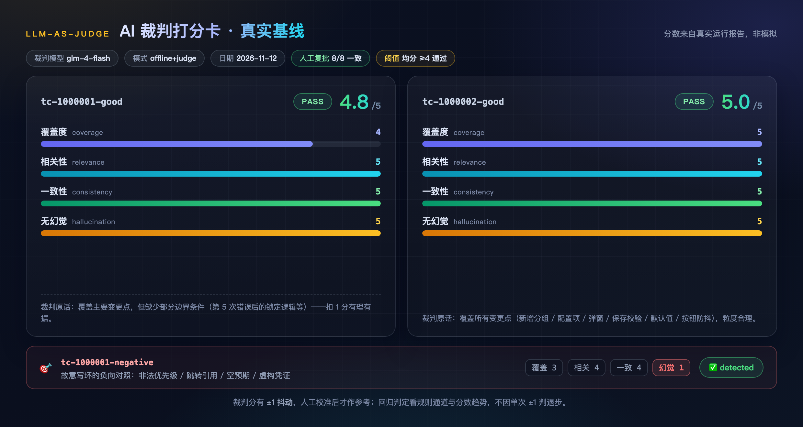
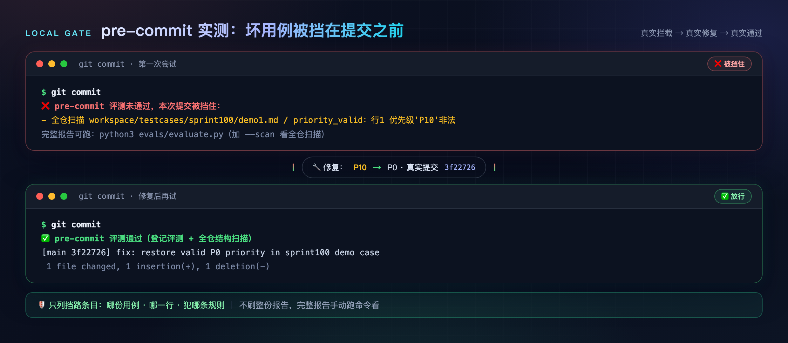

# evals — 用例"改作业"模块（无需 TAPD，克隆即跑）

> 一句话说明：这个模块是**改作业的老师**——只改已经写好的测试用例，不管用例是谁写的、怎么写的。
> 写用例是 testcase-generator skill 的事（它要去 TAPD 拿需求）；改用例是本模块的事（只看用例文件，全程不碰 TAPD）。
>
> Agent 用户：在 Qoder/Claude Code 里直接说 `/eval` 或"评测一下这份用例"（testcase-evaluator skill），
> 自动选模式、跑完人话解读；能力本体与教程仍是本模块。

## 先对号入座：你是哪种情况？

| 情况 | 你手里有什么 | 看哪节 |
|:---|:---|:---|
| 只想试试这个仓库 | 什么都没有（无 TAPD、无 key） | 情况 1 |
| 有大模型 API key，没有 TAPD | 一个 key | 情况 2（可用自带需求文字，也可用**你自己的需求文字**） |
| 团队有 TAPD 完整环境 | 全套环境 | 情况 3 |

## 情况 1：零 key 试用（改仓库自带的作业）

```bash
pip install pyyaml          # 唯一运行依赖（跑评测器自测另需 pytest，见「评测器自测」节）
python3 evals/evaluate.py
```

不需要 TAPD、不需要 key、不需要任何配置。仓库自带 12 份用例：3 份好的、9 份故意写坏的。
你会看到：好的 3 份通过；坏的 9 份全部被揪出——其中 1 份是"多处一起坏"的混合样本，另外 8 份每份只坏一处（8 条规则各有一发单规则隔离弹，证明每条规则独立可检出）；报告存到 `evals/reports/`。

## 情况 2：有 key，让 AI 当场写、当场改

key 是什么：任意 OpenAI 兼容大模型的 API key（比如智谱 GLM）。**只在终端 export，不写进任何文件**：

```bash
export GLM_API_KEY=你的key
python3 evals/evaluate.py --live
```

会发生什么：AI 读仓库自带的需求文字，当场写一份用例，然后老师改这份新作业。
注意这是**简化版**：AI 只看文字，不识别原型图、不查数据库。完整流程见情况 3。

想验证"换了 prompt 质量会不会掉"？一条命令跑 A/B 对比（正式版 prompt vs 故意弱化版），见「A/B prompt 回归演示」节。

### 有自己的需求文字？一条命令登记

准备两个文件：**需求文字**（纯文本写清楚即可：改了什么、规则是什么、提示文案是什么）和**你的用例文件**。然后：

```bash
python3 evals/evaluate.py --add 你的用例.md --fixture 你的需求.md --points ①②
```

这条命令会：把需求拷进 `evals/fixtures/`、在 `cases.yaml` 末尾追加一条登记（保留已有注释），之后每次评测都会带上你的用例。用例文件留在原地（按原路径引用，不拷贝）。

- `--points` 可以省略：会从用例文件的「变更点说明」表自动提取编号；
- **要脱敏**：别放真实公司名、账号密码、内网地址（这个仓库是公开的）。
- **想让裁判也靠谱点（v5 新增）**：在 `cases.yaml` 顶部的 `change_points:` 段里，按 fixture 路径给每个编号写一句变更点描述（编号必须与该用例的 `expected_change_points` 一致，pytest 会锁）。评测器会把这份清单直接喂给裁判，它就不必自己从需求里拆——v4 实测小模型自己拆会拆错、还会编出"覆盖 6/6"这种结论（bc-0005）。不写也能跑：裁判会收到"未登记"提示，自行拆分并在理由里先列出清单。

`--points`（即 YAML 里的 `expected_change_points`）是什么：你从需求里挑出的要点，自己编上 ①②③。AI 写用例时会给每条用例标注"测的是哪个要点"，老师按编号检查**每个要点是否都有用例测到**。

**想手写 YAML？** 也可以手动登记：需求文字放进 `evals/fixtures/`，再在 `evals/cases.yaml` 的 `cases:` 末尾加一条：

```yaml
  - id: my-first-case                 # 自己起名，别重复
    kind: positive
    fixture: fixtures/my-requirement.md
    output: ../你的用例文件路径.md      # 路径相对 evals/；用 --live（AI 当场写）时省略这行
    expected_change_points: ["①", "②"]
```

登记完跑情况 1 或情况 2 的命令。完事。

## 情况 3：团队完整流程（有 TAPD）

1. 照常用 testcase-generator 生成用例（**这一步才用 TAPD**）；
2. 需求文字脱敏后放 `fixtures/`，用例文件脱敏后放仓库任意位置；
3. 按情况 2 登记（`--add` 一条命令，或手写 fixture + output + expected_change_points）；
4. `python3 evals/evaluate.py`。

TAPD 只用在第 1 步"写"；改作业的老师依然不碰 TAPD。

## 老师改什么（两个通道）

**通道 1 规则检查（零 key 就有）**，8 项：

1. 用例表格式对不对（固定 9 列）；
2. 优先级是不是 P0/P1/P2；
3. 每条用例有没有标注测的哪个变更点；
4. 每个变更点是不是都有用例测到；
5. 有没有"见上文/参见/同上"这种让人翻来翻去的写法；
6. 预期结果有没有空着；
7. 有没有编造的密码、内网地址；
8. 有没有变更点说明。

**通道 2 再请一个 AI 打分（有 key 自动开启）**：覆盖全不全、相不相关、步骤和预期对不对得上、有没有编造，四个方面各打 1-5 分，平均 ≥4 算过。
没有 key 时这个通道**明确跳过，不编分数**。AI 打分不百分百准，正式使用前要抽样人工复批改一致率；校准前分数只作参考。

## 裁判校准实录（2026-11-12，真实运行）

AI 裁判第一次真实打分，抓出的竟是**裁判自己的问题**——这正是"校准"要干的事：

- **现象**：两份好用例的"无幻觉"维度都被打 1 分（最差），均分 3.5 低于及格线 4，被误判不合格。
- **人工复批改因**：一份的理由是"实际结果列未填写"——那一列本来就该执行时才填，空着正常；另一份的理由写"没有虚构"却给了 1 分——理由和分数自相矛盾，裁判没搞懂这个维度"分越高越干净"。
- **根因**：评分标准（judge prompt）没写清维度含义和方向，属评测集自身问题（evalset），不是用例的错。登记在 `badcases.yaml` bc-0001 / bc-0002。
- **修复**：给裁判补上维度定义（`DIM_DEFS`）和三条评审约定（实际结果列为空正常 / 理由必须与分数同向 / 文件头部元信息不参与打分）；评测集版本升至 v2（改标准必须升版本、重跑基线）。
- **复评**：两份好用例通过（v2 基线均分 4.8 / 5.0），负向对照仍全部检出。修复前原始报告存档为 `reports/calibration-2026-11-12-before.*`（v1），可对照。
- **同日 --live 全链路实测**：glm-4-flash 现场生成两份用例 → 规则 8/8 通过 → 裁判均分 5.0（live 报告与生成产物在 `_tmp/`，不入库）。

**人工校准结果（2026-11-12）**：复评的 8 个分数（2 份正样本 × 4 维度）经人工逐条复批，8/8 全部认可，一致率 100%，记录在 `calibration.yaml`（cal-0001）。注意样本量小，一致率只代表本批；评测集扩充后要继续抽样校准。
**2026-11-13 评测集扩至 v3（12 条）**：新增正样本 tc-1020256-executed 与 8 份单规则隔离负向对照已跑过 Judge（`reports/baseline-2026-11-13-165241.*`，12 条全有分数），但**尚未人工抽样复批**——按本节方法复批后追加 cal 记录，在此之前这批新样本的 Judge 分数只作参考（负向对照的判定本来就靠规则通道，不受影响）。

**2026-11-13 第二次校准：v3 → v4（收紧 coverage / consistency）**：A/B prompt 演示发现裁判对"格式与覆盖退化"几乎无感——B 变体那份产出规则通道查出变更点覆盖 0/5、缺变更点说明、6 列表格、4 处"同上"，裁判却给四维全 5.0（另两条也只 5.0 → 4.8/4.5，都在及格线内）。根因是评分标准写得太笼统（"5=变更点全覆盖且粒度合理"没有可执行的核对动作），属 evalset，登记 bc-0004。修法照三件套走：

- **改标准**：`coverage` 改成"先把需求拆成变更点清单 → 逐点核对有没有对应用例 → 按分数上限表打分（漏 1 点=3、漏 2 点以上=2、只写主流程=1）"，并要求 reason 写出核对结论；`consistency` 明确纳入输出契约（列结构完整、优先级只用 P0/P1/P2、不得出现"同上/见上文"，违背任一项不高于 3）；新增评审约定 4「格式退化不等于内容合格」与 5「先做变更点核对再评其余维度」；
- **升版本**：`cases.yaml` meta.version 3 → 4（规则通道与用例集本身没动，只动裁判标准）；
- **重跑基线**：`reports/baseline-2026-11-13-145132.*` 为 v4 零 key 基线，与 v3 基线 `--diff` 结果是"退步 0 / 变好 0 / 说明 1（版本不同）"——确认这次改标准没扰动规则通道；
- **重新校准（2026-11-13 export key 实跑，结论：方向对了但没达标）**：跑了三组真实 Judge——登记评测 `reports/baseline-2026-11-13-165241.*`（offline+judge，正样本均分 4.75 / 4.75 / 4.25，exit_ok True，覆盖 13/13）+ `FORCE=1 bash evals/ab-demo.sh`（`ab-demo/a/baseline-2026-11-13-170553.*`、`ab-demo/b/baseline-2026-11-13-170848.*`）。对照当初写下的验收标准「B 变体 coverage 掉到 4 分以下、A 变体仍高分」：
  - **方向对了**：B 的 coverage 从 v3 那轮的 5/5/5 掉到 **3/3/4**，理由里也开始出现"覆盖 x/y"的核对句式——可执行的核对程序确实被执行了；
  - **但没达标**：B 三份的四维均分是 4.50 / 4.50 / 4.75，**全部 ≥ 4，光靠 Judge 通道 B 依然算合格**（这轮判 fail 完全是规则通道顶住的）；
  - **核对结论是编的**：B 的 tc-1000001-good 实际覆盖 0 个变更点、连变更点说明都没有，裁判理由却写"变更点1、2、3、4、5、6均覆盖"；反过来 165241 里正样本 tc-1000001-good 规则通道确认 ①②③ 全覆盖，裁判却扣到 4 分说"②③无用例对应，仅覆盖 3/5"（这份 fixture 一共只有 3 个变更点）——既假阳也假阴；
  - **consistency 的上限没被执行**：B 三份都是 6 列非标准表格、优先级写"高/中"、还有"执行TC1操作"这类跨用例引用，契约违背至少三项，裁判全给 5 分并明写"优先级使用 P0/P1/P2"，与产物直接矛盾；
  - **A 臂这轮 exit_ok False**：`--live` 现场生成有波动，A 的 tc-1020256-executed 漏了变更点⑤（覆盖 12/13）；另有 1 条负向对照的 Judge 调用被远端断连（tc-neg-expected-empty，报告里如实显示"—"，不补分）；
  - **附带问题**：A 臂 v4 那轮的生成产物被脚本的快照 bug 覆盖丢失（脚本已改成按运行时间戳落盘 `cases-HHMMSS/`，B 臂产物抢救进 `b/cases-170848/`，测试锚点同步更新）；新登记 bc-0005（裁判虚构核对结论 / 上限指令未遵循）与 bc-0006（`JUMP_RE` 漏掉"执行TC1操作"式引用），均为 open 草稿，根因待人工确认。

**这次验证给出的判断**：机械可判的事——覆盖几个变更点、列数对不对、优先级合不合法——不能指望小模型裁判，它会把核对动作"演"出来但编结论；门禁必须落在规则通道，Judge 分数继续只作参考。下一步方向待选：把 `cases.yaml` 里的变更点清单直接喂进 judge prompt（让它核对给定清单而不是自己拆）、承认 coverage 归规则通道并放宽裁判上限、或换更强的裁判模型再测。

**2026-11-13 第三次校准：v4 → v5（把机械事实从裁判手里拿走）**：v4 实跑证明小模型会"演核对、编结论"（bc-0005，WL2O2O 认可归因 model，选定 (a)+(b) 组合治疗）。思路很直白：**能算的事别让它算，把算好的结果告诉它**。

- **喂事实（a）**：`cases.yaml` 新增 `change_points` 段，按 fixture 给出 ground-truth 变更点清单（编号由 pytest 锁定必须与该 fixture 下各 case 的 `expected_change_points` 完全一致），`build_judge_prompt()` 把它注入成【变更点清单（评测集给定的 ground truth，不要自己另拆一份）】；同时把规则通道检出的违规明细注入成【规则通道已检出的确定性违规（不得推翻、不得重算、不得视而不见）】——v4 那种"产物明明写着高/中，裁判理由却断言优先级使用 P0/P1/P2"的自相矛盾，现在被明文禁止。用例没登记清单时 prompt 会显式写"未登记"，让裁判自己拆并在 reason 里先列出清单，不留空给它瞎猜；
- **改 coverage（b）**：机械的"每个变更点有没有对应用例"归规则通道，裁判只评**场景充分性与粒度**（边界值、异常场景、状态分支、数据组合、步骤能不能照着执行），分数上限相应放宽，reason 必须落到具体缺口、禁止"覆盖充分"这类套话；`consistency` 改为语义一致性（术语统一、前置与步骤不矛盾、预期与步骤对得上、不依赖另一条用例）+ "规则通道有契约违背时不高于 3"；新增评审约定 4「分工」、6「禁止编造清单里没有的变更点」；
- **升版本**：`cases.yaml` meta.version 4 → 5（规则通道与用例集本身没动，只动裁判侧）；
- **重跑基线**：`reports/baseline-2026-11-13-205017.*` 为 v5 零 key 基线，与 v4 零 key 基线 `--diff` = **退步 0 / 变好 0 / 说明 1「版本不同」**；另外用一个不可达端点做了假 key 探测，确认新的 prompt 拼装不会让 Judge 通道崩（调用失败如实记 "—"，不补分）；pytest 101 → 107 条（新增：清单编号与 expected_change_points 一致性、prompt 注入清单与规则结论、无清单时的兜底文案、judge() 转发、主流程接线防回归）；
- **重新校准（待 key，未跑不得声称已生效）**：验收标准「B 变体 Judge 均分 < 4，且裁判理由不得与规则通道结论矛盾；A 变体仍高分」。命令：`python3 evals/evaluate.py` + `FORCE=1 bash evals/ab-demo.sh`，跑完按本节方法抽样人工复批、追加 `calibration.yaml`；
- **代价说清楚**：喂事实等于承认裁判在机械项上不再独立——它现在更像"在规则通道结论之上补语义判断"。用独立性换可靠性，这也是门禁始终只认规则通道的原因。

已知局限：小模型裁判偶尔仍会复读样本头部标注（负向对照的判定靠规则通道，不受影响）；同一产出复跑分数有 ±1 抖动（v2 复跑覆盖度 5→4，结论不变，见 calibration.yaml）——回归对比看规则通道与分数趋势，不因单次 ±1 判退步；**裁判宽松是实测过的真实风险，而且 v4 收紧后仍未根治**（v3 那轮 B 变体覆盖 0/5 被打 5.0；v4 这轮掉到 3/3/4 但均分仍过线、且核对结论是编的，见上），所以门禁必须以规则通道为准，Judge 分数只作参考，别把"裁判说合格"当结论。

校准后的打分卡长这样（v2 真实基线，分数与裁判理由均出自 `reports/baseline-2026-11-12.json`）：

<p align="center">
  
</p>

## 评测器自测（pytest）：评测器也要被评测

老师改作业，谁来改老师？除了负向对照（判别力自测）和人工校准，评测器还有一套单元测试锁住自己的行为：

```bash
pip install -r requirements.txt    # 运行依赖 pyyaml + 自测依赖 pytest
python3 -m pytest evals/tests -q   # 107 条用例，零 key，1 秒内跑完
```

- **测什么**：8 条规则的触发/不触发边界（含 `admin\d{3,}`、内网 IP 段 172.16–31、四种跳转引用写法等正则边界）、用例表解析（表头识别/分隔行/空行终止/多表合并/表头保留）、**表头漂移兜底**（被测输出漂成非标准列时按列名继续查内容，锚点用 A/B 演示的真实产物）、扫描逻辑（无表 MD 跳过、只报 6 项结构规则、fixtures 不在默认扫描根）、评测集完整性（cases/badcases/calibration 三个 YAML 的字段与枚举校验、引用文件存在性）、判别力保证（负向对照必须检出全部登记违规、正样本必须零违规——与退出码语义一致，评测集或规则被改坏会直接红）。
- **不测什么**：Judge 真实网络调用与 `--live`（需 key，属运行期行为，由上面的校准实录兜底）。这是刻意边界：单测只锁确定性逻辑，不引入外部依赖。
- CI 每次 push/PR 会先跑这套自测再跑登记评测与扫描（`.github/workflows/evals.yml`）；pre-commit 钩子保持两层不跑 pytest（避免强制装依赖，秒级优先）。

## 报告在哪、怎么看

- `evals/reports/baseline-日期-时分秒.md`：给人看的报告；文件名带时分秒，**同日重跑互不覆盖**（先跑 Judge 基线再零 key 重跑，两份都在，谁也不会顶掉谁）；
- 同名 `.json`：给机器看的，两份喂给 `--diff` 就是回归报告（见下节）；
- 命令退出码 0 = 全过，1 = 有失败。仓库已挂好 CI（`.github/workflows/evals.yml`）：每次 push/PR 自动跑评测器 pytest 自测 + 登记评测 + 全仓扫描三层（零 key），失败亮红叉（配合分支保护可挡合并），README 顶部有徽章。Judge 通道不在 CI 跑（不在 CI 存 key），本地 export key 即可启用。

## 回归对比（--diff）：两次报告一比就是回归报告

改了 prompt、换了模型、调了规则之后，前后各跑一次评测，一条命令看逐用例逐规则的变好/变坏：

```bash
python3 evals/evaluate.py --diff evals/reports/baseline-旧.json evals/reports/baseline-新.json
```

- 输出三类条目：**❌ 退步**（新增违规、结论变差、Judge 大幅下降、覆盖度/判别力下降）、**✅ 变好**、**ℹ️ 说明**（评测集版本差异、新增/移除用例、±1 抖动——不判退步但要人工留意）；
- **Judge 单维 ±1 不判退步**：小模型复跑本来就有 ±1 抖动（见 calibration.yaml），降幅 ≥2 才算退步；规则通道是确定性的，任何新增违规都算退步；
- 退出码：退步 > 0 → 1，否则 → 0——可直接当 prompt 回归门禁（一键跑法见「A/B prompt 回归演示」节）；
- 扫描报告（scan-*.json）之间也能比；登记评测和扫描报告不能混比（会明确报错）；
- 评测集版本不同时会给警告：评分标准变过，对比仅供参考。

真实效果（校准前 v1 报告 vs 修复后 v2 基线，`--diff` 真实输出节选）：

```markdown
## 结论
- ❌ 退步 0 项 · ✅ 变好 9 项 · ℹ️ 说明 2 项

## ✅ 变好（新报告更好）
- 总体结论 exit_ok：False → True
- tc-1000001-good 结论：fail → pass
- tc-1000001-good / Judge hallucination：1 → 5
……
## ℹ️ 说明（不判退步，人工留意）
- tc-1000001-negative / Judge hallucination：2 → 1（±1 运行间抖动，不判退步）
```

## A/B prompt 回归演示：改一版 prompt，质量掉了能不能自动发现

`--diff` 是"两次报告一比"，A/B 演示是把它跑成一条命令：**同一套评测集、同一个模型，只换被测 prompt**，看评测器能不能自动判定退步。

```bash
export GLM_API_KEY=sk-xxx        # 只走环境变量，脚本不写盘、不打印
bash evals/ab-demo.sh            # 已有报告的变体自动跳过（断点续跑）；FORCE=1 强制重跑
```

- **变体 A** = `prompts/testcase-generator.public.md`（正式版：禁止跳转引用、优先级白名单、变更点说明表、9 列表头、覆盖矩阵）；
- **变体 B** = `prompts/variant-b-weakened.md`（**故意弱化的反面教材**：允许写"同上"、放开 P3 和"高/中/低"、不要求变更点表与覆盖矩阵、列数按需精简、只写 5 条主流程用例）；
- 每个变体 = 3 次现场生成 + 12 次 Judge 调用，约 2-5 分钟；产物落 `evals/ab-demo/{a,b}/`（报告 json+md，`cases-HHMMSS/` 是那一轮现场生成的用例快照，按运行时间戳分目录，重跑不覆盖旧证据），对比报告落 `evals/ab-demo/diff-*.md`。

真实运行结果（2026-11-13，glm-4-flash，评测集 v3 标准，`diff-baseline-…092720-vs-…093523.md` 节选）：

```markdown
- 旧：2026-11-13（live+judge，评测集 v3）   ← 变体 A
- 新：2026-11-13（live+judge，评测集 v3）   ← 变体 B

## 结论
- ❌ 退步 37 项 · ✅ 变好 4 项 · ℹ️ 说明 5 项

## ❌ 退步（新报告更差）
- 总体结论 exit_ok：True → False
- 变更点覆盖：13/13 → 0/13
- tc-1000001-good 结论：pass → fail
- tc-1000001-good / format_columns 新增违规：行1 列数6≠9
- tc-1000001-good / change_section 新增违规：缺少变更点说明
- tc-1000001-good / coverage 新增违规：变更点①未被任何用例覆盖
……
```

A 干净（3 条正样本 Judge 四维全 5.0、覆盖 13/13、`exit_ok=True`），B 一换上去就被判退步 37 项、对比退出码 1——这个退出码可以直接当 CI 里的 prompt 回归门禁。

**这次演示还顺手抓出评测器自己的三个问题**（都记入 `badcases.yaml`；前两个根因已由 WL2O2O 确认，第三个衍生的 bc-0005/bc-0006 还是 open 草稿，等人工确认）：

1. **规则通道有盲区（bc-0003，已修）**：老实现遇到"列数≠9"的行只报格式违规就 `continue`，后面 5 项行级检查全跳过。B 变体输出的正是 6 列表格，于是里面的 `P3`、"高/中"优先级、前置条件里的"同上"、缺失的关联引用列**当时全部漏检**（B 报告里 `priority_valid`/`no_jump_refs`/`traceability` 三项合规率还显示 100%）。现在表头非标准时改成**按列名兜底检查**：`P3`、"高"、"同上"都能揪出来（`pytest -k HeaderDrift` 有合成用例，`-k AbDemo` 直接拿这次 B 的真实产物当锚点）。表格结构漂移不该把内容缺陷一起藏起来。
2. **小模型裁判对格式退化几乎无感（bc-0004，已确认并治疗 → 评测集 v4）**：B 变体那份 `tc-1020256-executed` 产出，规则通道查出变更点覆盖 0/5、缺变更点说明、4 处"同上"，Judge 却给了**四维全 5.0**（另两条也只从 5.0 掉到 4.8/4.5，都在 ≥4 的及格线内）。结论很直接：**光靠 LLM 裁判当门禁会放过这种退步**，确定性规则通道不是可选项；收紧评分标准而不是调阈值糊过去：`coverage` 改为「先拆变更点清单 → 逐点核对 → 按分数上限表打分」，`consistency` 纳入输出契约（列结构/P0-P2/禁止「同上」），新增评审约定 4「格式退化不等于内容合格」；评测集 v3 → v4，v4 零 key 基线已重跑（与 v3 对比：退步 0 / 变好 0 / 说明 1「版本不同」，证明没扰动规则通道）。**v4 的 Judge 已 export key 实跑验证，结论是"方向对了但没达标"**：B 的 coverage 从 5/5/5 掉到 3/3/4，但四维均分 4.50/4.50/4.75 仍全部过线（这轮判 fail 靠的还是规则通道），而且裁判的核对结论是编的——B 那份覆盖 0 点的产出被写成"变更点1~6均覆盖"，反过来 ①②③ 全覆盖的正样本被扣成"仅覆盖 3/5"。详见「裁判校准实录」节与 bc-0005。据此又做了 v5：把变更点清单与规则通道结论直接喂给裁判、coverage 只评场景充分性（见「裁判校准实录」第三次校准），v5 的 Judge 效果同样待 key 复跑验证。
3. **第二轮 A/B 实跑（v4 标准，`diff-…170553-vs-…170848.md`）**：退步 **50 项**（比 v3 那轮的 37 项更多，因为表头漂移兜底现在能把 6 列表格的每一行都记上，其中 46 项是 B 臂新增的行级规则违规），变更点覆盖 12/13 → 0/13，对比退出码仍是 1。这轮 A 臂 `exit_ok` 自己是 False——`--live` 现场生成有波动，A 的 tc-1020256-executed 漏了变更点⑤，于是这条用例在 diff 里"两边都 fail"、看不到结论翻转。**教训**：live 模式的 A/B 不能只盯 `exit_ok` 有没有翻，要逐条看退步项落在哪（基线臂自己也可能不干净）；生成波动本身也是被测 prompt 的质量信号，不该被平均掉。

## 全仓结构扫描（--scan）

登记评测只守"在册作业"；扫描层守**所有**用例文件，未登记的也跑不掉：

```bash
python3 evals/evaluate.py --scan
```

- 扫描根：`workspace/testcases/`、`examples/`、`demo/`（项目约定的用例存放目录），递归扫所有含用例表的 MD；用例放在别处？`--scan-root 目录路径` 指定（可多次）；
- 查 6 项不需要需求原文的结构规则：9 列格式、P0/P1/P2、关联引用非空、无跳转引用、预期结果非空、无虚构凭证；
- 覆盖度与变更点说明依赖需求原文，留给登记评测；`evals/fixtures/` 里故意写坏的负向对照不扫；
- 钩子跑"登记评测 + 扫描"两层，CI 在这之上还跑评测器 pytest 自测（见「评测器自测」节）：结构问题全仓拦，内容质量登记评，评测器自身坏了 CI 拦。

## 本地提交门禁（pre-commit 钩子，可选）

CI 在推送后才在云端跑；想在**本地提交时**就自动检测，装个钩子：

```bash
cp evals/hooks/pre-commit .git/hooks/pre-commit
chmod +x .git/hooks/pre-commit
```

效果：每次 commit 前自动跑两层检查——登记评测（在册用例 8 项规则 + 负向对照自测）与全仓结构扫描（所有用例 MD 的 6 项结构规则）；强制零 key，秒级；报告写临时目录，不碰正式基线。通过放行；失败挡住提交，**只列挡路条目**（哪份用例、哪一行、犯哪条规则），不刷整份报告，完整报告手动跑命令看。

真实拦截实录（仓库里那份 P10 优先级就是这么被挡下、修复后才放行的）：

<p align="center">
  
</p>

注意：登记评测只检查 `cases.yaml` 登记在册的用例（评分需要配套的需求原文与变更点，见情况 2）；未登记文件由扫描层守结构。
钩子装在本地 `.git/hooks/`，不进仓库、换电脑要重装；急事可 `git commit --no-verify` 跳过（不建议常用）。

## 改出不合格怎么办

报告里会列每个问题，并**建议**根因：写的问题（prompt）/ AI 的问题（模型）/ 工具的问题 / 业务知识的问题 / 评分标准自己的问题。
人工确认后登记到 `badcases.yaml`，积累趋势；AI 的建议单独不算数。

## 常见问题

- **换模型/换厂商**：`EVAL_LLM_BASE_URL`、`EVAL_LLM_MODEL` 环境变量，或 `--judge-model` 单独指定打分模型；任何 OpenAI 兼容接口都行。
- **key 安全**：只从环境变量读，不落盘、不入库。
- **当前基线诚实声明**：`reports/baseline-2026-11-11.*` 为零 key 规则通道真实运行；`reports/baseline-2026-11-12.*` 为真实 Judge（glm-4-flash）离线基线（校准修复后复评，首批 8 条人工复批一致率 100%，见 `calibration.yaml`）；修复前原始报告存档为 `calibration-2026-11-12-before.*`；`reports/baseline-2026-11-13-063552.*` 为评测集 v3（12 条）零 key 基线，`reports/baseline-2026-11-13-145132.*` 为 v4（裁判标准收紧后）零 key 基线——两份的规则通道结果一致，`--diff` 只给出「版本不同」说明；`reports/baseline-2026-11-13-205017.*` 为 v5（裁判分工重划后）零 key 基线，与 v4 零 key 基线对比同样是退步 0 / 变好 0 / 说明 1。带 Judge 分数的真实运行有三份，**都是 v4 裁判标准下跑的、也都还没做人工抽样复批**（v5 的 Judge 分数尚不存在，待 key 复跑），一致率待补记 `calibration.yaml`：`reports/baseline-2026-11-13-165241.*`（v4 标准，offline+judge，12 条全有分数）、`ab-demo/a/baseline-2026-11-13-092720.*` + `ab-demo/b/baseline-2026-11-13-093523.*`（**v3 裁判标准**下的 A/B 演示，bc-0004 的证据）、`ab-demo/a/baseline-2026-11-13-170553.*` + `ab-demo/b/baseline-2026-11-13-170848.*`（**v4 裁判标准**下的 A/B 复跑，验证结论见「裁判校准实录」：收紧后仍未达标）。另：v4 那轮 A 臂的现场生成产物因脚本快照 bug 被覆盖丢失（脚本已修，B 臂产物在 `b/cases-170848/`），报告 json/md 完整。样本量小，后续运行仍建议抽样复批。